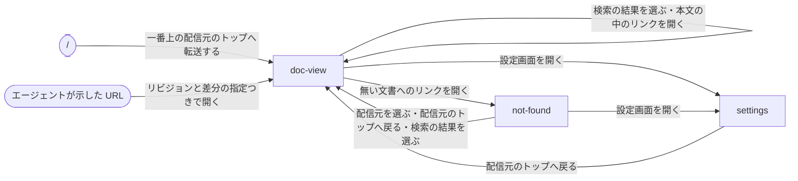

# 開発ドキュメントサーバー

## 現状

<!-- table: data -->

| 分類 | ページ / ファイル | 概要 | 補足 |
| --- | --- | --- | --- |
| ドキュメント | [dev/設計書/モジュール構成/開発ドキュメントサーバー/入口.py.yaml](https://github.com/shuhei1101/dev-docs/blob/develop/dev/%E8%A8%AD%E8%A8%88%E6%9B%B8/%E3%83%A2%E3%82%B8%E3%83%A5%E3%83%BC%E3%83%AB%E6%A7%8B%E6%88%90/%E9%96%8B%E7%99%BA%E3%83%89%E3%82%AD%E3%83%A5%E3%83%A1%E3%83%B3%E3%83%88%E3%82%B5%E3%83%BC%E3%83%90%E3%83%BC/%E5%85%A5%E5%8F%A3.py.yaml) | `dev-docs` コマンドの入口（`--version`・`--help`・サブコマンドの登録先） | `serve` を登録先に追加する |
| ドキュメント | [dev/設計書/シナリオ/複合ユースケース/dev-docsで文書を配信して読み書きする.yaml](https://github.com/shuhei1101/dev-docs/blob/develop/dev/%E8%A8%AD%E8%A8%88%E6%9B%B8/%E3%82%B7%E3%83%8A%E3%83%AA%E3%82%AA/%E8%A4%87%E5%90%88%E3%83%A6%E3%83%BC%E3%82%B9%E3%82%B1%E3%83%BC%E3%82%B9/dev-docs%E3%81%A7%E6%96%87%E6%9B%B8%E3%82%92%E9%85%8D%E4%BF%A1%E3%81%97%E3%81%A6%E8%AA%AD%E3%81%BF%E6%9B%B8%E3%81%8D%E3%81%99%E3%82%8B.yaml) | S0〜S9 の複合ユースケース | 書き換え前の設計（`projects[]`・`/{name}/mcp`）のまま |
| 実装 | [src/dev_docs/__main__.py](https://github.com/shuhei1101/dev-docs/blob/develop/src/dev_docs/__main__.py) | 入口だけ。サブコマンドは無い | - |
| 実装 | [tests/unit/dev_docs/test_main.py](https://github.com/shuhei1101/dev-docs/blob/develop/tests/unit/dev_docs/test_main.py) | 入口の単体テスト | - |
| 実装 | [pyproject.toml](https://github.com/shuhei1101/dev-docs/blob/develop/pyproject.toml) | 実行時の依存は無い | サーバー・MCP・YAML・描画の依存を追加する |
| 土台（他のリポジトリ） | ai-monitor の `src/ai_monitor/features/dev_docs/`・`features/design_docs/`・`mcp/design_docs.py`（約 9,970 行） | 今の開発ドキュメントサーバーと設計書の MCP | R-36 の振り分けで汎用の部分だけを切り出す。ai-monitor の設定・ラベルへの参照は持ち込まない |

<!-- /table -->

## 変更方針

<!-- table: data -->

| 対象 | 方針 | 補足 |
| --- | --- | --- |
| 待ち受け | 1 プロセスが `127.0.0.1:8781`（`DEV_DOCS_PORT`）で画面・`/mcp`・`/_admin/mcp` を待ち受ける。ポートが使用中なら起動を止め、ポートと `DEV_DOCS_PORT` を出す | 非機能要件の `listen_port`・`bind_address` |
| 端末の設定の読み込み | `DEV_DOCS_CONFIG` の YAML をスキーマで検証し、`sources[]` の各行の `config` を上から順にマージする | マージの決まりは要件の「端末の設定」 |
| 起動時の検証 | 配信元ごとに設定とスクリプトを確かめ、失敗した配信元だけを配信から外してエラーログに残す | 他の配信元と `/_admin/mcp` は止めない |
| 権限 | 読み取り・書き込みのたびに `cwd` を `scope.read`・`scope.write` の glob と照らす。`cwd` が無い呼び出しは作業場所なしとして扱い、どの `scope` にも当たらない | `cwd` はフック（#4）が入れる |
| 作業中の配信元・ワークツリー | `cwd` を含む一番深い配信元のフォルダを作業中の配信元にする。読み書きのツールの `worktree` の引数が `worktrees` に当たるパスなら、そのワークツリーの同じ相対パスの設定と文書を読み書きする。`worktree` を省き `cwd` がワークツリーの中なら、そのワークツリーを指す | `CLAUDE_BASH_MAINTAIN_PROJECT_WORKING_DIR=1` では `cwd` がクローン本体のままになる（PoC 結果） |
| ストア | 文書の YAML・Markdown を `documents[].paths` の glob と `records`・`body_file` で読み、文書ごとに内容のハッシュをバージョンとして持つ。ファイルが変わっていれば次の取得で読み直す | ai-monitor の `store.py`・`item_path.py` を土台にする |
| 履歴 | `@{ref}` のリビジョンを `git archive` で書き出して使い回し、区間（commit・日時・ブランチ・タグ）を commit に解決して差分を作る | ai-monitor の `history.py`・`diff.py` |
| 検索（`search_docs`） | 条件の木・`view`・`fields`・`order_by`・`group_by`・`cursor`・`max_chars`・`snippets` と、複数の配信元の横断 | 入力のスキーマは `$ref` で再帰させる |
| 書き込み（`write_docs`・`delete_docs`） | 操作を全て当ててから 1 回だけ検証し、通ったときだけ一時ファイルから置き換える。読み込み・検査・書き込みを配信元ごとの排他ロックの中で行い、書いた後に `generators[]` を流す | ai-monitor の `write.py` |
| `describe`・`list_changes`・`trace_related` | A-14 のとおり。`list_changes` の `from`・`to` を省いたときは、この会話で前回読んだ時点から今まで | - |
| 1 セッション 1 回 | 会話キーごとに返した文書の id とハッシュを記録する | 記録の置き場所は設計で決める |
| 変換 | 既定はスキーマ駆動の変換（ai-monitor の `markdown.py`・`diagrams.py`・`schema_page.py`）、`converters[]` を指す種類は子プロセスのスクリプト。制限時間を超えたスクリプトは止めて失敗として返す | 制限時間は非機能要件で決める |
| 検査 | スキーマ・YAML・参照・タグの検査を持ち、`validators[]` のスクリプトを書き込みの前に流す | ai-monitor の `validate.py`・`references.py`・`tags.py` |
| 画面 | ai-monitor の `route.py`・`view.py`・`toc.py`・`resolve.py`・`search.py`・`columns.py` を土台に、URL を `/{配信元の id}/` にし、`nav` からタブとサイドバーを組み立てる。本文の描画は mdmark | 表の列の設定は端末の `state_dir` に置く |
| 設定のバージョン | 端末の設定と `dev-docs.yaml` の `version` が古い配信元を、配信元の状態として持つ | 知らせる経路は #4 |
| エラー返却 | MCP のエラーは `isError: true` で返し、A-14 の「エラー」の表のとおり原因と次の手を本文に書く | - |
| 外部ライブラリ | Web サーバー・MCP の Python SDK・YAML の読み書き・JSON Schema の検証・mdmark の版を選んで `pyproject.toml` に入れる | ライブラリ選定で決める |

<!-- /table -->

### 画面一覧

どの画面もトップバー（配信元の切り替え・リビジョンの切り替え・検索・コメント・設定・明暗の切り替え）と、タブ・サイドバーの枠を共有する。
見た目は採用スタイル [開発者ツール](../../mock/styles/developer-tool/index.html) に揃える。

| 種別 | 画面 | 概要 | アクション | 判定の根拠 | 補足 |
| --- | --- | --- | --- | --- | --- |
| 新規 | `doc-view` | `/{配信元の id}[@{ref}]/{パス}[?diff={ref}]` で、1 文書の本文と目次。`/{配信元の id}/{タブ}/` はそのタブのサイドバーの一番上の文書、`/{配信元の id}/` は一番左のタブの一番上の文書を開く | タブを切り替える<br>サイドバーで別の文書を選ぶ<br>目次の見出しへ移る<br>表の列の表示を切り替える<br>リビジョンを切り替える<br>差分の強調を解除する<br>本文の中のリンクを開く<br>パンくずで上の階層へ戻る<br>配信元を切り替える<br>検索して結果を選ぶ<br>選んだ文字列にコメントする<br>溜めたコメントをまとめてコピーする<br>溜めたコメントで Issue を作成する<br>設定画面を開く<br>明暗を切り替える | 本文を読みながら目次で移るため、目次は本文の横に補助の区画として並べる。リビジョン（`@{ref}`）と差分の強調（`?diff=`）は同じ文書の見せ方の切り替えのため、同じ画面の中で切り替える。検索・配信元・リビジョン・列の表示は今の画面を見ながら選ぶため、トップバーと表の上から開くポップオーバーにする。コメントは本文を見ながら溜めるため、本文の横に開くパネルにする | タブに件数は出さない。Issue の作成は `dev-docs.yaml` に GitHub のリポジトリを書いた配信元だけ。スマホ幅では目次を本文の上で開閉し、サイドバーをトップバーのボタンで開くドロワーにする。文書の無いタブは本文に文書が無いことを出す |
| 新規 | `settings` | `/_settings/` で、端末の設定の `sources[]` の一覧と編集 | 配信元を追加する<br>配信元を削除する<br>`enabled`・`config`・`scope` を編集する<br>保存する<br>配信元のトップへ戻る | 端末全体の設定で、どの配信元にも属さないため、配信元の画面と別の画面にする | 配信元ごとの状態（配信中・起動時の検証で外した理由・設定のバージョンが古い）を並べる。保存はスキーマに通ったときだけ `settings.yaml` を書き換えて読み直し、通らなければ違反したキーと理由を出す。削除は確認のダイアログを挟む |
| 新規 | `not-found` | 無い配信元・文書・リビジョンを開いたときの 404 | 配信元を選ぶ<br>配信元のトップへ戻る<br>検索して結果を選ぶ<br>設定画面を開く | どの画面にも当たらない URL の行き先のため、別の画面にする | 無いものが配信元・文書・リビジョンのどれかを本文に出す |

`/` の論点: `/` を開いたときに何を出すか。

| 案 | 内容 | メリット | デメリット |
| --- | --- | --- | --- |
| A | 端末の設定で一番上の配信元のトップ（一番左のタブの一番上の文書）へ転送する | 1 手で文書に届く。配信元のトップと同じ決まりで済む | 2 つ目以降の配信元へは、トップバーの配信元の切り替えから移る |
| B | 設定画面を出す | 配信元の一覧と状態を最初に確かめられる | 文書を読むのに毎回 1 手増える |

推奨: A（`未確定`。決める段: モック作成）

`/` から読みたいのは文書で、配信元の一覧と状態は設定画面で見られるため。

### 画面遷移



ポップオーバー（検索・配信元・リビジョン・列の表示）・コメントのパネル・スマホ幅のドロワーは閉じるだけで、ブラウザの履歴に積まない。
Issue の作成は GitHub の画面を別のタブで開く。

## PoC 結果

検証構成: プラグイン `pocdocs`（`--plugin-dir` で読み込み）の PreToolUse のフックが、`mcp__plugin_pocdocs_docs__.*` の呼び出しに `updatedInput`（permissionDecision なし）で `cwd`・`session_id`・`agent_id` を重ね、HTTP の MCP サーバー（mcp 2.3.0 の `MCPServer`）が受け取った引数を記録する。
claude 2.1.310 の `claude -p --permission-mode default --setting-sources project` で流した。

<!-- table: data -->

| 検証構成 | 成功条件 | 結果 | PoC PR | 補足 |
| --- | --- | --- | --- | --- |
| H1 | `cwd`（起動したフォルダ）: 一時リポジトリとその下のフォルダで起動し、起動したフォルダの絶対パスになる | ✅ 2 回とも一致 | [#13](https://github.com/shuhei1101/dev-docs/pull/13)（closed） | - |
| H1 | `cwd`（`cd` の後）: 下のフォルダ・ワークツリーへ `cd` してから呼び、移動先の絶対パスになる | ❌ 環境変数なしは 2 回とも移動先、`CLAUDE_BASH_MAINTAIN_PROJECT_WORKING_DIR=1` では 2 回とも起動したフォルダ | [#13](https://github.com/shuhei1101/dev-docs/pull/13)（closed） | 環境変数ありでは `cd` が毎回戻される（`results-maintain/`）。利用者の端末のエージェントはこの環境変数を持ち、クローン本体で起動する |
| H1 | `cwd`（外へ `cd`）: 記録して評価する | ✅ 起動したフォルダ | [#13](https://github.com/shuhei1101/dev-docs/pull/13)（closed） | `default` では `cd` が拒否された。reviewer の実測では `bypassPermissions` で `cd` は実行され、次の呼び出しの `cwd` は起動したフォルダに戻った。`CLAUDE_PROJECT_DIR` は起動したフォルダ |
| H1 | `session_id`: フックの入力の値と一致する | ✅ 7 回とも一致 | [#13](https://github.com/shuhei1101/dev-docs/pull/13)（closed） | - |
| H1 | `agent_id`: メインでは空、サブエージェントでは値が入りフックの入力と一致する | ✅ メイン 6 回とも空・サブエージェントは `aac1d575d6e3c1d0a` | [#13](https://github.com/shuhei1101/dev-docs/pull/13)（closed） | フックの入力の `agent_type` は `general-purpose` |
| H1 | 引数の上書き: モデルが `cwd:"/tmp/fake"` 等を渡してもフックの値になる | ✅ 3 つとも上書き | [#13](https://github.com/shuhei1101/dev-docs/pull/13)（closed） | - |
| H1 | permissionDecision なし: 許可した probe の引数にフックの値が入る | ✅ 7 回とも入る | [#13](https://github.com/shuhei1101/dev-docs/pull/13)（closed） | - |
| H1 | 許可の確認を保つ: 許可していない probe_delete は拒否され、サーバーに届かない | ✅ 届いた 0 件 | [#13](https://github.com/shuhei1101/dev-docs/pull/13)（closed） | フックは許可の確認より前に動き、拒否された呼び出しの入力にもフックの値が入っていた |
| H1 | 他の引数を保つ・再帰する入力スキーマ: and の中の or の中の Condition の 3 段の filter が指示どおりに届く | ✅ 7 回とも一致 | [#13](https://github.com/shuhei1101/dev-docs/pull/13)（closed） | 入力スキーマは `$defs.Group` が `$ref` で自分を指す |

<!-- /table -->

結論: 一部不成立。
フックの `updatedInput` だけで、HTTP の MCP ツールの引数に `cwd`・`session_id`・`agent_id` を入れられ、モデルが渡した値も上書きできる。
`cwd` で作業中の配信元と `scope` は決められるが、`CLAUDE_BASH_MAINTAIN_PROJECT_WORKING_DIR=1` の環境では、書き込む作業ツリーを `cwd` で決められない。
permissionDecision を付けなくても許可の確認は残る。
`$ref` で再帰する入力スキーマのツールも、Claude Code から 3 段の木で呼べる。

所感:

- 利用者の端末のエージェントは `CLAUDE_BASH_MAINTAIN_PROJECT_WORKING_DIR=1` を持ち、クローン本体で起動してワークツリーをパスで指して作業する。この運用では `cwd` が常にクローン本体になり、`write_docs` はクローン本体を書き換える
- 起動したフォルダの外へ `cd` しても、次の呼び出しの `cwd` は起動したフォルダに戻る（`default` では拒否、`bypassPermissions` では実行後に戻る）。`scope` の判定は `cwd` だけで行える。`--add-dir` で追加した作業フォルダへの `cd` は測っていない
- 対話のダイアログでの許可の確認は測っていない。`-p` の拒否を「確認のまま」とみなした

書き込む作業ツリーは、読み書きのツールの `worktree` の引数で決める（[確認ログ](./確認ログ.md) の案 A）。

最小再現コードの要点（[plugin/hooks/inject.py](https://github.com/shuhei1101/dev-docs/blob/0f8e4364c552dab55317f0f48b66ba8cd9c3b762/poc/hook-injected-args/plugin/hooks/inject.py)）:

```python
payload = json.load(sys.stdin)
tool_input = payload.get("tool_input", {})
# モデルが渡した値を、フックの入力の値で上書きする
updated = {
    **tool_input,
    "cwd": payload.get("cwd"),
    "session_id": payload.get("session_id"),
    "agent_id": payload.get("agent_id") or "",
}
print(json.dumps({"hookSpecificOutput": {"hookEventName": "PreToolUse", "updatedInput": updated}}))
```

```json
{"matcher": "mcp__plugin_pocdocs_docs__.*", "hooks": [{"type": "command", "command": "python3 \"${CLAUDE_PLUGIN_ROOT}/hooks/inject.py\""}]}
```

diff の見どころ:

- `plugin/`: プラグインの `.mcp.json`（URL のポートを環境変数で渡す）と `hooks/hooks.json`・`hooks/inject.py`
- `server.py`: `Group` と `Condition` の Pydantic のモデルで `$ref` の再帰を作り、受け取った引数を `args.jsonl` に書く
- `run.py`: 一時リポジトリ・ワークツリー・外のフォルダを作り、8 ケースを `claude -p` で流して `args.jsonl` と `hook.jsonl` を突き合わせる
- `results/run.log`・`results-maintain/run.log`: 環境変数なし・ありの実測

## テスト結果

なし
