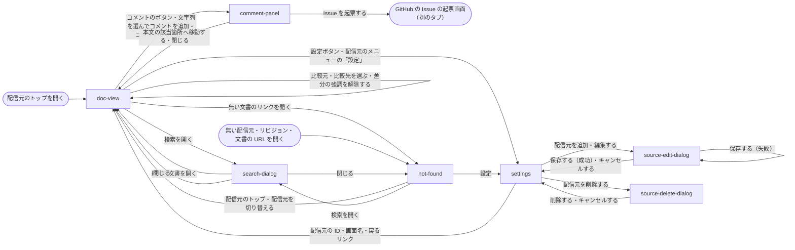

# 画面

画面のサブシステムの追加は、要件のとおり A（`画面` のサブシステムを追加する）で計画する。

## 現状

<!-- table: data -->

| 分類 | ページ / ファイル | 概要 | 補足 |
| --- | --- | --- | --- |
| ドキュメント | [dev/設計書/画面設計/index.yaml](https://github.com/shuhei1101/dev-docs/blob/develop/dev/%E8%A8%AD%E8%A8%88%E6%9B%B8/%E7%94%BB%E9%9D%A2%E8%A8%AD%E8%A8%88/index.yaml) | 画面設計の目次 | 項目が無い |
| ドキュメント | [dev/設計書/部品設計/index.yaml](https://github.com/shuhei1101/dev-docs/blob/develop/dev/%E8%A8%AD%E8%A8%88%E6%9B%B8/%E9%83%A8%E5%93%81%E8%A8%AD%E8%A8%88/index.yaml) | 部品設計の目次 | 項目が無い |
| ドキュメント | [dev/設計書/開発コマンド/開発コマンド.yaml](https://github.com/shuhei1101/dev-docs/blob/develop/dev/%E8%A8%AD%E8%A8%88%E6%9B%B8/%E9%96%8B%E7%99%BA%E3%82%B3%E3%83%9E%E3%83%B3%E3%83%89/%E9%96%8B%E7%99%BA%E3%82%B3%E3%83%9E%E3%83%B3%E3%83%89.yaml) | 開発コマンド | `frontend/` のビルド・lint・Storybook のコマンドが無い |
| ドキュメント | [dev/設計書/テスト/テスト実行方法.yaml](https://github.com/shuhei1101/dev-docs/blob/develop/dev/%E8%A8%AD%E8%A8%88%E6%9B%B8/%E3%83%86%E3%82%B9%E3%83%88/%E3%83%86%E3%82%B9%E3%83%88%E5%AE%9F%E8%A1%8C%E6%96%B9%E6%B3%95.yaml) | テスト実行方法 | Vitest・Storybook・Playwright の層が無い |
| ドキュメント | [dev/設計書/外部ライブラリ/index.yaml](https://github.com/shuhei1101/dev-docs/blob/develop/dev/%E8%A8%AD%E8%A8%88%E6%9B%B8/%E5%A4%96%E9%83%A8%E3%83%A9%E3%82%A4%E3%83%96%E3%83%A9%E3%83%AA/index.yaml) | 外部ライブラリの目次 | React・Vite・TanStack Router・TanStack Query・TanStack Table・orval・Zod・shadcn/ui・Tailwind CSS・Storybook・MSW・mdmark・lint と Git フックの道具の設計書が無い |
| 参考 | [文書の画面のモック](https://github.com/shuhei1101/dev-docs/blob/6d2fded64c5d4cd2322000d3a0382bf0c369926d/dev/mock/pages/doc-view/12/default/index.html) | PR #12 のモック | 参考にして見た目を整える |
| 参考 | [見つからない画面のモック](https://github.com/shuhei1101/dev-docs/blob/6d2fded64c5d4cd2322000d3a0382bf0c369926d/dev/mock/pages/not-found/12/default/index.html) | PR #12 のモック | 参考にして見た目を整える |
| 参考 | [設定画面のモック](https://github.com/shuhei1101/dev-docs/blob/6d2fded64c5d4cd2322000d3a0382bf0c369926d/dev/mock/pages/settings/12/default/index.html) | PR #12 のモック | 参考にして見た目を整える |
| 参考 | [画面設計](https://github.com/shuhei1101/dev-docs/blob/6d2fded64c5d4cd2322000d3a0382bf0c369926d/dev/%E8%A8%AD%E8%A8%88%E6%9B%B8/%E7%94%BB%E9%9D%A2%E8%A8%AD%E8%A8%88) | PR #12 の画面設計（文書の画面・設定画面・見つからない画面） | 要素を再現する |
| 実装 | `frontend/`（新規） | React の SPA | 無い |
| 実装 | `package.json`（新規） | 直下の npm scripts | 無い |

<!-- /table -->

## 変更方針

<!-- table: data -->

| 対象 | 方針 | 補足 |
| --- | --- | --- |
| フォルダ構成 | `frontend/` を knowledge のReact の規約『フォルダ構成』に従って分け、import の向きを eslint-plugin-boundaries で検査する | Vite・tsconfig などの設定は直下に置く（A-3） |
| ルーティング | TanStack Router で文書の画面・設定画面・見つからない画面を切り替え、配信元・リビジョン・差分・検索の語を `validateSearch` + Zod で URL に持つ | 文書の画面は `/{配信元の ID}/{文書のパス}?rev=&base=`、設定画面は `/_settings` |
| 閲覧機能 | 文書の取得の結果からタブ・サイドバー・パンくず・目次を組み立て、本文を CDN の mdmark の `mount` で描画する | - |
| 検索機能 | トップバーの検索から画面の検索を呼び、件数と一致した箇所を出す | - |
| 表 | 本文の表の件数と列の表示は mdmark が描く | 隠した列は画面の API の表の列の設定の保存で送る。隠す列の受け渡しは mdmark の付け替え口を通す |
| 編集機能 | 設定画面の配信元の追加・編集・削除をダイアログで行い、`sources[]` を丸ごと送る | スキーマに通らないときは保存の失敗のまとめを出す |
| コメント | 本文の文字列にコメントを追加・修正・削除し、まとめてコピー・Issue の起票ができる | ブラウザのタブの `sessionStorage` に溜める。追加は mdmark の `commentStore` を通す |
| エラー表示 | Problem Details の `detail`・`errors[]` を画面に出し、無い配信元・リビジョン・文書は見つからない画面にする | - |
| 状態表示 | 読み込み中・空の状態・変換の失敗を、knowledge の React の部品（Suspense・空の状態・ErrorBoundary）で出す | - |
| API クライアント | orval で TanStack Query のフック・Zod・MSW のモックを生成し、生成物を手で直さない | 画面の API に knowledge#84 の決まりを当てた後に生成する |
| デザイン | shadcn/ui（Base UI 版）+ Tailwind v4 のトークンで PR #12 のモックを整え直す。明暗の切り替えを持つ | デザインスタイル選定で方向を決める |
| モック | Storybook（react-vite）のストーリーに、MSW と props でデータを差し込む | shuhdev-gateway の公開 URL で見る |
| アクセシビリティ | jsx-a11y の lint と、Storybook の addon-a11y・Playwright の axe の検査を通す | - |
| レスポンシブ対応 | 幅 360px 以上を扱い、48rem 未満でサイドバーをドロワーにする | 非機能要件の `対応する画面サイズ` |
| 保守性 | eslint-plugin-better-tailwindcss・react-hooks・複雑さの lint を error で入れ、lefthook で commit の前に流す | - |

<!-- /table -->

### 画面一覧

本文の中の機能（表の件数・列の表示・差分の強調）は mdmark が描くため、載せない。

<!-- table: data -->

| 種別 | 画面 | 概要 | アクション | 判定の根拠 | 補足 |
| --- | --- | --- | --- | --- | --- |
| 新規 | `doc-view` | 文書の画面。1 文書の本文を種類のタブ・サイドバー・パンくず・文書の情報・目次と一緒に読む | 種類のタブを選ぶ サイドバーの文書を開く パンくずの階層を開く 目次の見出しへ移る 本文のリンクを開く リビジョンのメニューから比較を始める 差分の比較元・比較先を選ぶ 差分の強調を解除する 本文の文字列を選んでコメントを追加する 本文の右のコメントのマーカーを押す 狭い幅でサイドバーをドロワーで開く 本文へスキップする ショートカットの一覧を開く（`?`） | 文書の一覧（サイドバー）から 1 件を選んで中身を見る関係のため、一覧と詳細を並べる。種類の切り替えは同じ画面の別のまとまりのため画面内のタブ、差分の有無と比較元・比較先は同じ内容の見せ方の切り替えのため同じ画面の中で切り替える | URL は `/{配信元の ID}/{文書のパス}?rev=&base=`。種類のタブとサイドバーはスクロールしても画面に残す。差分のとき、サイドバーの文書に追加・変更・削除、目次に変更のあったセクションのマーカーを文字を添えないアイコンで出す。変換に失敗した文書は本文の代わりに変換の失敗を出す |
| 新規 | `settings` | 設定画面。端末の設定の配信元を状態とともに並べる | 配信元のトップを開く 配信元を追加する 配信元を編集する 配信元を削除する 1 文字のショートカットを切り替える ショートカットの一覧を開く 文書の画面へ戻る | 文書の画面と見比べず、一覧と詳細の関係でもないため、別の画面にし、トップバーで行き来する | - |
| 新規 | `not-found` | 見つからない画面。無い配信元・リビジョン・文書を開いたときに、見つからなかったものと次のリンクを出す | 配信元のトップを開く 設定画面を開く | 他の画面と並べる関係が無いため、別の画面にする | - |
| 新規 | `components/topbar` | 3 画面に共通のトップバー | 画面名から配信元のトップを開く 配信元を切り替える リビジョンを切り替える 検索を開く（Ctrl+K・`/`） コメントのパネルを開閉する 設定画面を開く 明暗を切り替える | 3 画面で同じ役割のため、部品にして作り分けない | 設定画面では配信元・リビジョンの切り替え・検索・コメントを出さない。見つからない画面ではコメントを出さない。設定画面への入口はトップバーの歯車だけにする |
| 新規 | `search-dialog` | 検索のダイアログ。語で文書を探し、件数と一致した箇所を出す | 語を入れる 結果の文書を開く 閉じる | 本文を見ながら入力せず、入力が 1 項目でスクロールせずに収まるため、モーダルにする | 文書の画面と見つからない画面から開く。Esc 1 回で閉じる |
| 新規 | `comment-panel` | コメントのパネル。溜めたコメントの一覧と書く枠 | コメントを書く・追加する コメントを修正する（アイコンのボタン） コメントを削除する（アイコンのボタン） コメントを選ぶ・すべて選ぶ 本文の該当箇所へ移動する 選んだコメントを文書のパスとともにコピーする Issue を起票する 閉じる | 本文を見ながら書くため、文書の画面の横に出すパネルにする。1 件の修正はパネルの中のその場で行う | 狭い幅では本文の下から出す面にする。コピー・起票の結果は通知で出す |
| 新規 | `source-edit-dialog` | 配信元の追加・編集。ID・設定ファイル・配信・読み取りの範囲・書き込みの範囲を入れる | 入力する 追加・保存する 保存の失敗のまとめから入力欄へ移る キャンセルする | 入力が 5 項目で 2 項目ほどに収まらないため別画面になるが、要件の `機能の再現` が追加・編集をダイアログとしているため、設定画面の上に開くダイアログにする | 編集は追加と同じ置き方にする |
| 新規 | `source-delete-dialog` | 配信元の削除の確認 | 削除する キャンセルする | 取り消せない操作の確認のため、モーダルにする | - |
| 新規 | `shortcut-dialog` | キーボードのショートカットの一覧 | 閉じる | 本文を見ながら確かめず、一覧がスクロールせずに収まるため、モーダルにする | 3 画面の `?` と、設定画面のキーボードのセクションのリンクから開く |

<!-- /table -->

文書の画面の URL は、画面設計で A に決めた。

| 案 | 内容 | メリット | デメリット |
| --- | --- | --- | --- |
| A | `/{配信元の ID}/{文書のパス}` に、開くリビジョン・比較元・検索の語を search パラメータ（`?rev=`・`?base=`・`?q=`）で持つ | TanStack Router の `validateSearch` + Zod で全ての状態を同じ方法で検査できる。比較先は `rev`、比較元は `base` で 2 点がそろう | PR #12 と ai-monitor の `dev_docs` の URL（`/{配信元の ID}@{ref}/{パス}?diff=`）が開けなくなる |
| B | PR #12 の `/{配信元の ID}@{ref}/{パス}?diff={比較元}` を保つ | 既存の URL のまま開ける | パスの 1 つ目のセグメントから `@{ref}` を切り出す処理が要り、リビジョンだけ `validateSearch` の外になる |

推奨: A

PR #12 の画面は develop に入っておらず、移す前の `dev_docs` の URL を開ける要件も無い。状態を search パラメータにそろえると、比較元・比較先を選ぶ操作が URL の 1 か所の書き換えで済む。
設定画面のパスと配信元の ID が衝突しないこと（`/_api/`・`/mcp`・`/_admin/` の予約と同じ扱い）も、あわせて決める。

### 画面遷移

## テスト結果

単体テスト: [20261031004605_76cbe2c_単体テスト.log](https://github.com/shuhei1101/dev-docs/blob/feat/frontend/react-spa/dev/pr/36/%E3%83%86%E3%82%B9%E3%83%88%E7%B5%90%E6%9E%9C/20261031004605_76cbe2c_%E5%8D%98%E4%BD%93%E3%83%86%E3%82%B9%E3%83%88.log)（結合テストは結合テスト作成で記入する）

lint: [20261031005049_76cbe2c_lint.log](https://github.com/shuhei1101/dev-docs/blob/feat/frontend/react-spa/dev/pr/36/%E3%83%86%E3%82%B9%E3%83%88%E7%B5%90%E6%9E%9C/20261031005049_76cbe2c_lint.log)
