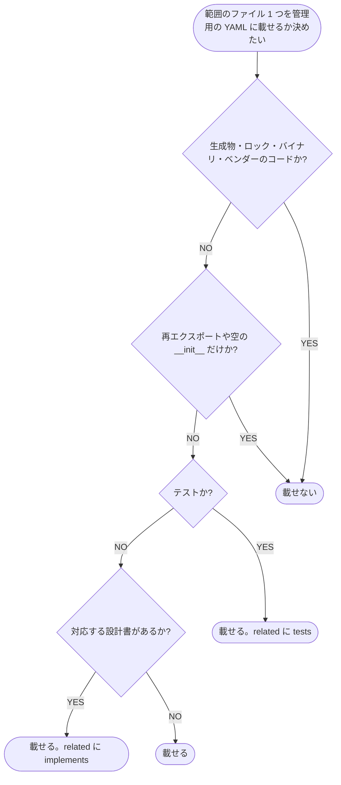

# 要件

## 要望

管理用の YAML（`files.yaml`）の行に入れる値の決まり（Issue の D-173〜D-177）を、スキーマ・関連の種類・setup・索引の同期に入れる。

<!-- table: data -->

| 対象 | 終わりの条件 |
| --- | --- |
| `templates/files.schema.yaml` | `path`・`name`・`description`・`tags`・`related`・`status` の各列の `description` に、下の「列に入れる値」の表の入れる値と入れないものを記載する。IDE の補完で読める |
| `related.types[]` の既定 | `references`・`depends_on`・`see_also` に `implements`（コード → 設計書）・`tests`（テスト → コード）を加える。既定のまま `implements`・`tests` を書いた行が検査に通る |
| 設計書から実装への被参照 | `search_docs` には条件を追加しない。既存の `trace_related` を設計書を起点に `direction: in` で呼び、結果の `via_type` が `implements` の文書がその設計書を実装するコード、という引き方を `trace_related` のツールの説明と公開ドキュメントに記載する |
| `/dev-docs:setup` の行の作り方 | 範囲のファイルを下の「載せるファイルの判定」で振り分け、除外に当たるファイルの行を作らない。テストのファイルには `tests` の関連の候補（対象のコード）を、設計書の名前が対応するコードには `implements` の候補（その設計書）を付け、候補の表で確かめてから書く |
| 索引に無いファイルの知らせ（`unindexed_files`） | 下の「載せるファイルの判定」の除外の条件に当たるファイルを数えない。`check_project`・状態の取得・起動時の警告の件数が同じ数え方になる |
| 公開ドキュメント | 下の `## 更新ドキュメント` のページに、列に入れる値・`implements`・`tests`・除外の条件・被参照の引き方を記載する |

<!-- /table -->

列に入れる値（D-173・D-174・D-175・D-177）:

<!-- table: data -->

| 列 | 入れる値 | 入れないもの |
| --- | --- | --- |
| `path` | 管理用の YAML のフォルダからの相対パス。1 行 1 ファイル | glob |
| `name` | 何のファイルかを表す日本語の名詞句（例 `タスクのリポジトリ`） | クラス名・ファイル名の繰り返し |
| `description` | 1 文で「何を受け持つか」と「どんなときに読むか」（例 `タスクの保存と取得を受け持つ。保存先や検索の条件を変えるときに読む`） | 関数の一覧・実装の手順 |
| `tags` | `topic`（扱う概念）・`tool`（使うライブラリ・外部サービス） | `kind`・`scope`・状態・評価の語 |
| `related` | `implements`（コード → 設計書。設計書と 1 対 1 の部分は必ず書く）・`tests`（テスト → コード）・`see_also` | import で分かる依存・逆向き（設計書 → コード）の関連 |
| `status` | `deprecated` など検索で外したい状態だけ | - |

<!-- /table -->

載せるファイルの判定（D-176）:

`未確定`: 除外の条件（生成物・ロック・バイナリ・ベンダーのコード・再エクスポートや空の `__init__`）の見分け方（決める段: モジュール構成設計）

| 案 | 内容 | メリット | デメリット |
| --- | --- | --- | --- |
| A | サーバーが固定の判定を持つ。ロックはファイル名、ベンダーと生成物はフォルダ名・`.gitignore`、バイナリは先頭の NUL バイト、`__init__.py` は中身が空か import と `__all__` だけかで見分ける。setup はサーバーの判定を使う | 設定を増やさず、setup と `unindexed_files` が同じ判定になる | プロジェクト固有の生成物は既存の `exclude[]` で外す |
| B | 判定の一覧を `dev-docs.yaml` の設定にし、既定値を持たせる | プロジェクトごとに変えられる | 既存の `exclude[]` と役割が重なる |

推奨: A

プロジェクト固有の除外は #26 で入れた `documents[].exclude[]` が既に受け持っており、設定を重ねずに済む。

`未確定`: setup の `implements` の候補の「設計書の名前が対応する」の決め方（決める段: 単一ユースケース設計）

| 案 | 内容 | メリット | デメリット |
| --- | --- | --- | --- |
| A | モジュール構成の設計書の `test_files`・`implementation`・ディレクトリ構成に書かれたパスと、ファイルのパスが一致するものを候補にする | 設計書の記載から機械的に決まる | 設計書がパスを持たない配信元では候補が出ない |
| B | 設計書のファイル名（拡張子を除く）とコードのファイル名の一致で候補にする | 設計書の書式に依らない | 名前の付け方が揃っていない配信元で誤った候補が出る |

推奨: A

候補は利用者が表で確かめるが、誤った候補が多いと確かめる手間が増えるため、記載から決まる方を既定にする。

## 影響するユースケース

<!-- table: data -->

| 種別 | ユースケース | 影響 | 依存 |
| --- | --- | --- | --- |
| 複合ユースケース | [dev/設計書/シナリオ/複合ユースケース/dev-docsで文書を配信して読み書きする.yaml](https://github.com/shuhei1101/dev-docs/blob/develop/dev/%E8%A8%AD%E8%A8%88%E6%9B%B8/%E3%82%B7%E3%83%8A%E3%83%AA%E3%82%AA/%E8%A4%87%E5%90%88%E3%83%A6%E3%83%BC%E3%82%B9%E3%82%B1%E3%83%BC%E3%82%B9/dev-docs%E3%81%A7%E6%96%87%E6%9B%B8%E3%82%92%E9%85%8D%E4%BF%A1%E3%81%97%E3%81%A6%E8%AA%AD%E3%81%BF%E6%9B%B8%E3%81%8D%E3%81%99%E3%82%8B.yaml) | なし（単一ユースケースの箱のつながりは変わらない） | |
| 単一ユースケース | [dev/設計書/シナリオ/単一ユースケース/配信元を追加する.yaml](https://github.com/shuhei1101/dev-docs/blob/develop/dev/%E8%A8%AD%E8%A8%88%E6%9B%B8/%E3%82%B7%E3%83%8A%E3%83%AA%E3%82%AA/%E5%8D%98%E4%B8%80%E3%83%A6%E3%83%BC%E3%82%B9%E3%82%B1%E3%83%BC%E3%82%B9/%E9%85%8D%E4%BF%A1%E5%85%83%E3%82%92%E8%BF%BD%E5%8A%A0%E3%81%99%E3%82%8B.yaml) | 変更（setup が除外の条件に当たるファイルの行を作らず、テストに `tests`・設計書が対応するコードに `implements` の候補を出す） | |
| 単一ユースケース | [dev/設計書/シナリオ/単一ユースケース/エージェントが調べる.yaml](https://github.com/shuhei1101/dev-docs/blob/develop/dev/%E8%A8%AD%E8%A8%88%E6%9B%B8/%E3%82%B7%E3%83%8A%E3%83%AA%E3%82%AA/%E5%8D%98%E4%B8%80%E3%83%A6%E3%83%BC%E3%82%B9%E3%82%B1%E3%83%BC%E3%82%B9/%E3%82%A8%E3%83%BC%E3%82%B8%E3%82%A7%E3%83%B3%E3%83%88%E3%81%8C%E8%AA%BF%E3%81%B9%E3%82%8B.yaml) | 変更（設計書を起点に `trace_related` の `direction: in` で `implements` のコードを引くシナリオを追加する） | |
| 単一ユースケース | [dev/設計書/シナリオ/単一ユースケース/エージェントが書き込む.yaml](https://github.com/shuhei1101/dev-docs/blob/develop/dev/%E8%A8%AD%E8%A8%88%E6%9B%B8/%E3%82%B7%E3%83%8A%E3%83%AA%E3%82%AA/%E5%8D%98%E4%B8%80%E3%83%A6%E3%83%BC%E3%82%B9%E3%82%B1%E3%83%BC%E3%82%B9/%E3%82%A8%E3%83%BC%E3%82%B8%E3%82%A7%E3%83%B3%E3%83%88%E3%81%8C%E6%9B%B8%E3%81%8D%E8%BE%BC%E3%82%80.yaml) | 実行のみ（`implements`・`tests` の関連を既定の設定で書ける） | |
| 単一ユースケース | [dev/設計書/シナリオ/単一ユースケース/起動する.yaml](https://github.com/shuhei1101/dev-docs/blob/develop/dev/%E8%A8%AD%E8%A8%88%E6%9B%B8/%E3%82%B7%E3%83%8A%E3%83%AA%E3%82%AA/%E5%8D%98%E4%B8%80%E3%83%A6%E3%83%BC%E3%82%B9%E3%82%B1%E3%83%BC%E3%82%B9/%E8%B5%B7%E5%8B%95%E3%81%99%E3%82%8B.yaml) | 実行のみ（起動時の警告の索引に無いファイルの件数が除外の条件で変わる） | |
| 単一ユースケース | [dev/設計書/シナリオ/単一ユースケース/設定・スクリプトを変える.yaml](https://github.com/shuhei1101/dev-docs/blob/develop/dev/%E8%A8%AD%E8%A8%88%E6%9B%B8/%E3%82%B7%E3%83%8A%E3%83%AA%E3%82%AA/%E5%8D%98%E4%B8%80%E3%83%A6%E3%83%BC%E3%82%B9%E3%82%B1%E3%83%BC%E3%82%B9/%E8%A8%AD%E5%AE%9A%E3%83%BB%E3%82%B9%E3%82%AF%E3%83%AA%E3%83%97%E3%83%88%E3%82%92%E5%A4%89%E3%81%88%E3%82%8B.yaml) | 実行のみ（`check_project` の索引の同期の件数が除外の条件で変わる） | |

<!-- /table -->

## 更新ドキュメント

<!-- table: data -->

| ページ | 更新内容 | 状態 |
| --- | --- | --- |
| [templates/files.schema.yaml](https://github.com/shuhei1101/dev-docs/blob/develop/templates/files.schema.yaml) | 各列の `description` に入れる値と入れないものを記載する | 未 |
| [dev/設計書/設定/開発ドキュメントサーバー.yaml](https://github.com/shuhei1101/dev-docs/blob/develop/dev/%E8%A8%AD%E8%A8%88%E6%9B%B8/%E8%A8%AD%E5%AE%9A/%E9%96%8B%E7%99%BA%E3%83%89%E3%82%AD%E3%83%A5%E3%83%A1%E3%83%B3%E3%83%88%E3%82%B5%E3%83%BC%E3%83%90%E3%83%BC.yaml) | `related.types[]` の既定に `implements`・`tests` を加える | 未 |
| [docs/リファレンス/設定.md](https://github.com/shuhei1101/dev-docs/blob/develop/docs/%E3%83%AA%E3%83%95%E3%82%A1%E3%83%AC%E3%83%B3%E3%82%B9/%E8%A8%AD%E5%AE%9A.md) | `related.types[]` の既定に `implements`・`tests` を加え、管理用の YAML の列の表に入れる値を記載する | 未 |
| [docs/はじめに/コアコンセプト/文書のメタデータ.md](https://github.com/shuhei1101/dev-docs/blob/develop/docs/%E3%81%AF%E3%81%98%E3%82%81%E3%81%AB/%E3%82%B3%E3%82%A2%E3%82%B3%E3%83%B3%E3%82%BB%E3%83%97%E3%83%88/%E6%96%87%E6%9B%B8%E3%81%AE%E3%83%A1%E3%82%BF%E3%83%87%E3%83%BC%E3%82%BF.md) | `## 管理用の YAML` に 1 行 1 ファイル・載せるファイルの判定・`implements`・`tests` の向きを記載する | 未 |
| [docs/使い方/配信元を配信する.md](https://github.com/shuhei1101/dev-docs/blob/develop/docs/%E4%BD%BF%E3%81%84%E6%96%B9/%E9%85%8D%E4%BF%A1%E5%85%83%E3%82%92%E9%85%8D%E4%BF%A1%E3%81%99%E3%82%8B.md) | setup が除外の条件で行を作り、`implements`・`tests` の候補を出すことを記載する | 未 |
| [docs/リファレンス/文書のMCP.md](https://github.com/shuhei1101/dev-docs/blob/develop/docs/%E3%83%AA%E3%83%95%E3%82%A1%E3%83%AC%E3%83%B3%E3%82%B9/%E6%96%87%E6%9B%B8%E3%81%AEMCP.md) | `trace_related` の `direction: in` と `via_type` で設計書を実装するコードを引く使い方を記載する | 未 |
| [docs/リファレンス/管理のMCP.md](https://github.com/shuhei1101/dev-docs/blob/develop/docs/%E3%83%AA%E3%83%95%E3%82%A1%E3%83%AC%E3%83%B3%E3%82%B9/%E7%AE%A1%E7%90%86%E3%81%AEMCP.md) | `unindexed_files` が除外の条件に当たるファイルを数えないことを記載する | 未 |

<!-- /table -->

## 変更箇所の由来

| 対象箇所 | commit | 目的 | 変更回数 | 影響 |
| --- | --- | --- | --- | --- |
| `src/dev_docs/features/sources/types.py` の `related_types` の既定 | [60ef5ca](https://github.com/shuhei1101/dev-docs/commit/60ef5ca)（`汎用の開発ドキュメントサーバー（文書の MCP・設定・検査・変換と画面の API）を作る (#12)`） | 汎用のサーバーの初期実装で、関連の種類の既定として一般的な 3 語を置いた（設計書とコードの対応は想定していなかった） | 1 回 | 既存の 3 語を残して 2 語を加える直し方は、既存の配信元の検査の結果を変えない |

## スコープ外

| 項目 | 理由 | 対応予定 |
| --- | --- | --- |
| `search_docs` に `related` の `to`・`type` で絞る条件を追加する | 受付判断で、既存の `trace_related` の `direction: in` と `via_type` で引けるため追加しないと決めた | 予定なし |
| setup が files.yaml の行を作ること自体と、漏れを `check_project` が知らせること | #32（PR #33）で入っている | 予定なし |
| dev-docs 自身の Markdown・ソースコードの files.yaml の行を書く | この PR の決まりに合わせて別の Issue で書く | #24 |
