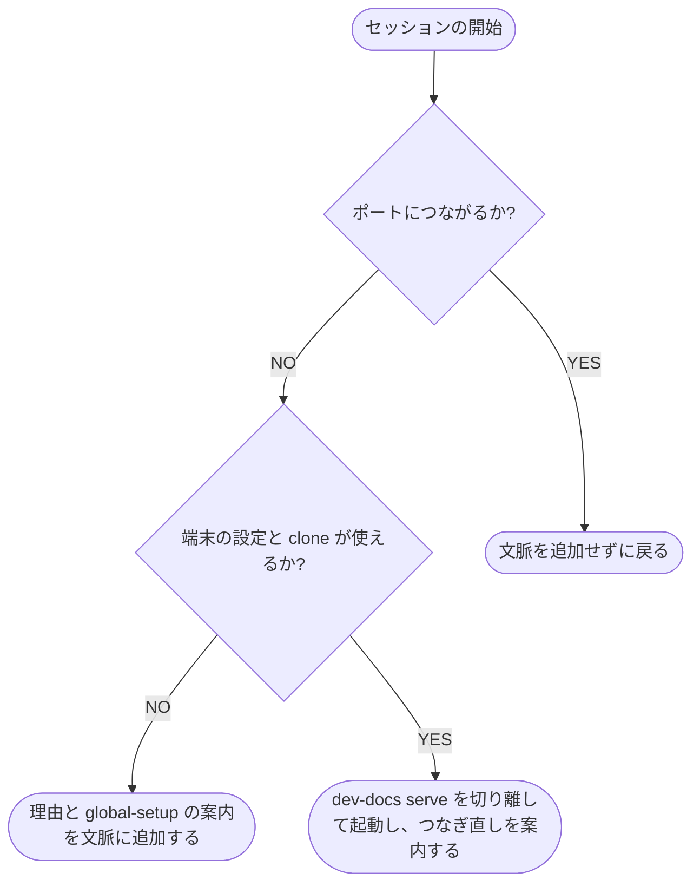

# 管理用プラグイン

プラグインが配る .mcp.json・フック・スキルと、起動・作業場所の受け渡しの仕組み

## 配るもの

dev-docs のリポジトリはマーケットプレイスで、プラグイン `dev-docs` を 1 つ載せています。
利用者はユーザースコープで入れるだけで、どの作業場所でも dev-docs を使えます。
各リポジトリはプラグインを持たず、ai-monitor にも依存しません。

| 配るもの | 内容 |
| --- | --- |
| `.mcp.json` | 管理の MCP `dev-docs-admin`（`http://127.0.0.1:${DEV_DOCS_PORT:-8781}/_admin/mcp`） |
| SessionStart のフック | 落ちているサーバーを起動する |
| スキル `/dev-docs:global-setup [クローンのパス]` | 端末の設定・Claude Code の env・起動を用意する |

スキルの使い方は [dev-docsを入れる](./dev-docsを入れる.md)、管理の MCP の引数は [管理のMCP](./管理のMCP.md) にあります。

## project-index のプラグインとの分担

文書の MCP・返し済みの記録の削除の依頼・作業場所の受け渡し（PreToolUse のフック）・配信元の登録のスキル（`setup`）は、project-index のプラグインが配ります。
文書の MCP を使う端末には project-index のプラグインを入れ、画面を使う端末にだけ dev-docs のプラグインを入れます。
仕組みは project-index の [コアコンセプト-プラグイン](https://github.com/shuhei1101/project-index/blob/develop/docs/guide/%E3%82%B3%E3%82%A2%E3%82%B3%E3%83%B3%E3%82%BB%E3%83%97%E3%83%88-%E3%83%97%E3%83%A9%E3%82%B0%E3%82%A4%E3%83%B3.md) にあります。

## 起動の仕組み

SessionStart のフックは、セッションが始まるたびに（`startup`・`resume`・`clear`・`compact`・`fork`）実行されます。
フックは Python の標準ライブラリだけで動き、`uv` を前提にしません。

- ポートへの接続は `127.0.0.1:${DEV_DOCS_PORT:-8781}` に 0.5 秒で打ち切る
- 起動は、`DEV_DOCS_CONFIG` が指す端末の設定の `clone:` の行から `{clone}/.venv/bin/python -m dev_docs serve` を組み立て、入出力を切り離して待たずに戻る
- 起動したセッションでは MCP の接続が間に合わないので、`/mcp` でつなぎ直す
- 端末の設定・`clone`・`{clone}/.venv/bin/python` のどれかが無いときは起動せず、理由と `/dev-docs:global-setup` の案内を文脈に追加する
- 複数のセッションが同時に起動しても、待ち受けるのは 1 つだけで、後から起動したプロセスはポート使用中で終わる

どの失敗でも、フックは終了コード 0 で戻り、セッションを止めません。
失敗の理由は文脈に追加します。

## 待ち受けているとき

つながったときは、フックは `source` によらず文脈を追加せずに戻ります。
dev-docs の状態と、project-index への接続は管理の MCP の `status` で取得します（[管理のMCP](./管理のMCP.md)）。
