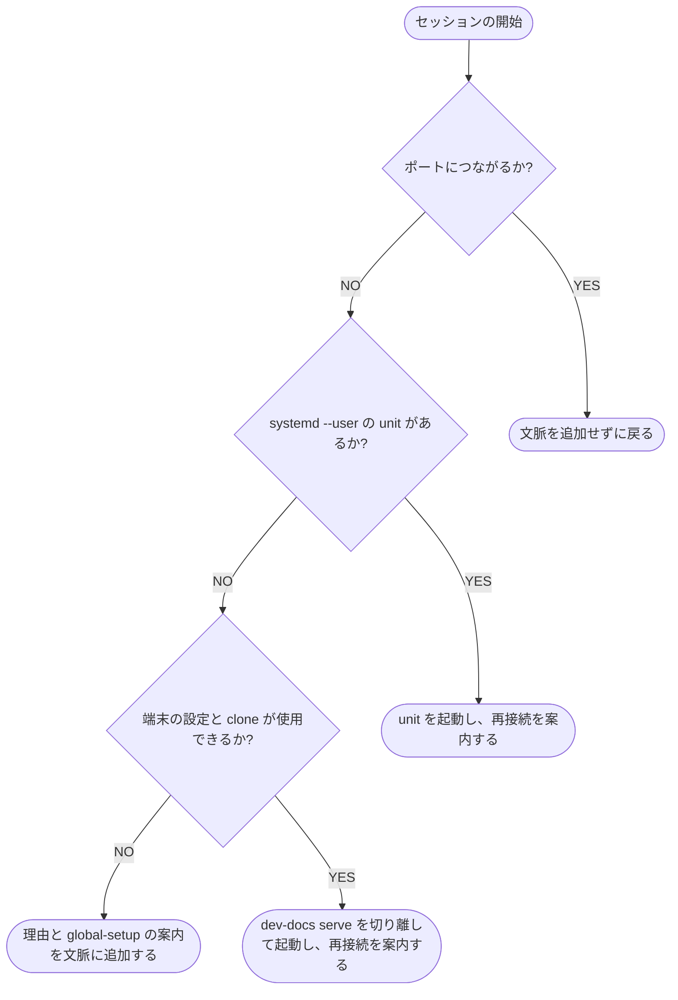

# 管理用プラグイン

プラグインが配る .mcp.json・フック・スキルと起動の仕組み、project-index のプラグインとの分担

## 配るもの

dev-docs のリポジトリはマーケットプレイスで、プラグイン `dev-docs` を 1 つ含めています。
利用者はユーザースコープで入れるだけで、どの作業場所でも dev-docs を使えます。
各リポジトリはプラグインを持たず、ai-monitor にも依存しません。

| 配るもの | 内容 |
| --- | --- |
| `.mcp.json` | 管理の MCP `dev-docs-admin`（`http://127.0.0.1:${DEV_DOCS_PORT:-8781}/_admin/mcp`） |
| SessionStart のフック | 落ちているサーバーを起動する |
| スキル `/dev-docs:global-setup [クローンのパス]` | 端末の設定・Claude Code の env・起動を用意する |

スキルの使用方法は [dev-docsを導入する](./dev-docsを導入する.md)、管理の MCP の引数は [管理のMCP](./管理のMCP.md) にあります。

## project-index のプラグインとの分担

文書の MCP・返却済みの記録の削除の依頼・作業場所の受け渡し（PreToolUse のフック）・配信元の登録のスキル（`setup`）は、project-index のプラグインが配ります。
文書の MCP を使用する端末には project-index のプラグインを入れ、画面を使用する端末にだけ dev-docs のプラグインを入れます。
仕組みは project-index の [コアコンセプト-プラグイン](https://github.com/shuhei1101/project-index/blob/develop/docs/guide/%E3%82%B3%E3%82%A2%E3%82%B3%E3%83%B3%E3%82%BB%E3%83%97%E3%83%88-%E3%83%97%E3%83%A9%E3%82%B0%E3%82%A4%E3%83%B3.md) にあります。

## 起動の仕組み

SessionStart のフックは、セッションが始まるたびに（`startup`・`resume`・`clear`・`compact`・`fork`）実行されます。
フックは Python の標準ライブラリだけで動き、`uv` を前提にしません。

<!-- map: {"title": "SessionStart のフックの起動の判定"} -->

<!-- /map -->

| 項目 | 動作 |
| --- | --- |
| ポートへの接続 | `127.0.0.1:${DEV_DOCS_PORT:-8781}` に 0.5 秒で打ち切る |
| unit の名前 | `DEV_DOCS_UNIT`（既定 `dev-docs.service`。空の文字列は unit を使用しない）。`systemctl --user cat` で unit があれば `systemctl --user start --no-block` で起動し、unit の外にはプロセスを起動しない |
| unit の有無が分からない・unit の起動に失敗した | 切り離しては起動せず、unit の名前と理由を文脈に追加する |
| unit が無いときの起動 | `DEV_DOCS_CONFIG` が指す端末の設定の `clone:` の行から `{clone}/.venv/bin/python -m dev_docs serve` を組み立て、入出力を切り離して待たずに戻る |
| 起動したセッション | MCP の接続が間に合わないので、`/mcp` で再接続する |
| 端末の設定・`clone`・`{clone}/.venv/bin/python` のどれかが無い | 起動せず、理由と `/dev-docs:global-setup` の案内を文脈に追加する |
| 複数のセッションの同時の起動 | 待ち受けるのは 1 つだけ。unit があるときは systemd が unit のプロセスを 1 つに保ち、unit が無いときは後から起動したプロセスがポート使用中で終わる |

どの失敗でも、フックは終了コード 0 で戻り、セッションを止めません。
失敗の理由は文脈に追加します。

## 待ち受けているとき

つながったときは、フックは `source` によらず文脈を追加せずに戻ります。
dev-docs の状態と、project-index への接続は管理の MCP の `status` で取得します（[管理のMCP](./管理のMCP.md)）。
