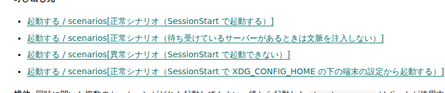
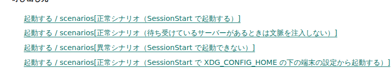
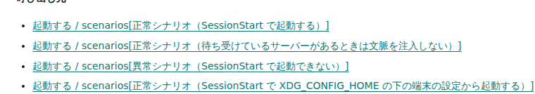
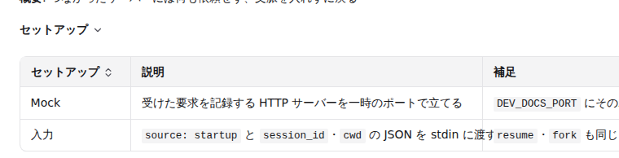
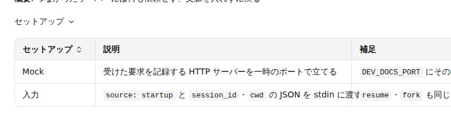
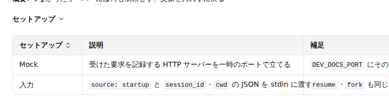
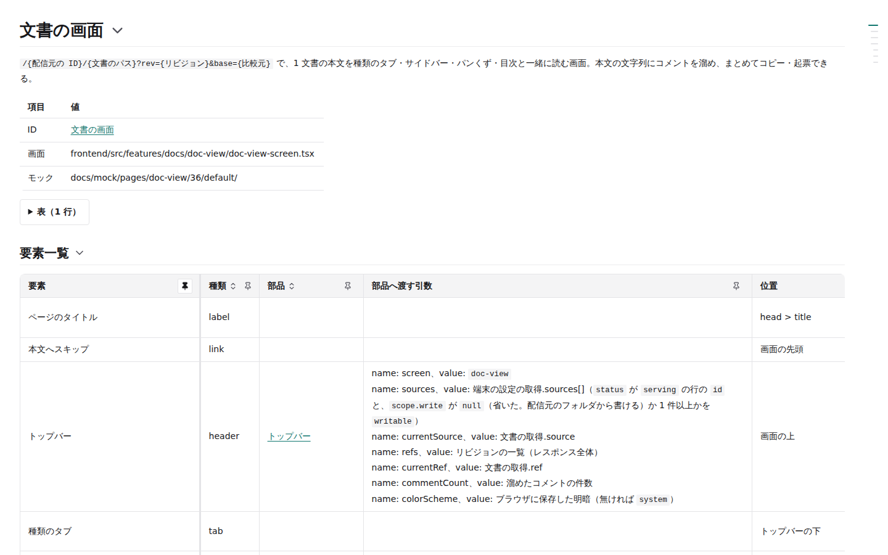
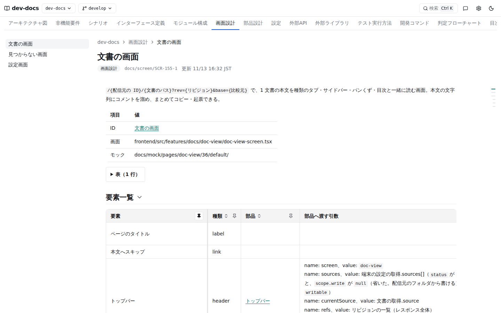
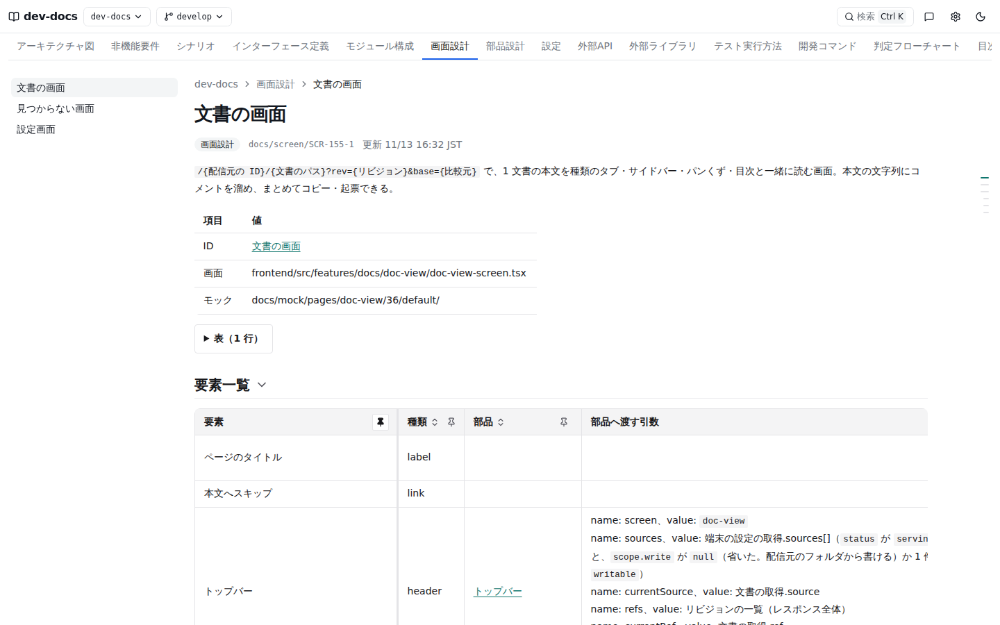

# 画面

## 現状

| 分類 | ページ / ファイル | 概要 | 補足 |
| --- | --- | --- | --- |
| ドキュメント | [docs/screen/SCR-155-1.yaml](https://github.com/shuhei1101/dev-docs/blob/develop/docs/screen/SCR-155-1.yaml) | 文書の画面の画面設計。`本文`・`目次`・`列の表示のメニュー`・`コメントの追加` は mdmark が描く | 本文の見た目の決まりを持たない |
| ドキュメント | [docs/module/MOD-155-50.css.yaml](https://github.com/shuhei1101/dev-docs/blob/develop/docs/module/MOD-155-50.css.yaml) | 画面全体の CSS。mdmark が描く本文への上書きは `.mdmark-html pre` だけ | 更新対象 |
| ドキュメント | [docs/module/MOD-155-25.ts.yaml](https://github.com/shuhei1101/dev-docs/blob/develop/docs/module/MOD-155-25.ts.yaml) | mdmark の JS と `dist/index.css` の読み込み | CSS の読み込み方を変えるときの更新対象 |
| ドキュメント | [docs/module/MOD-155-10.tsx.yaml](https://github.com/shuhei1101/dev-docs/blob/develop/docs/module/MOD-155-10.tsx.yaml) | mdmark で描く本文の要素 | 本文の要素のクラスを変えるときの更新対象 |
| ドキュメント | [docs/design-policy.md](https://github.com/shuhei1101/dev-docs/blob/develop/docs/design-policy.md) | 画面全体のデザイン方針 | 本文の文字・色の扱い |
| 実装 | [frontend/src/index.css](https://github.com/shuhei1101/dev-docs/blob/develop/frontend/src/index.css) | Tailwind の読み込み・基本のスタイル（`@layer base` の `*` の枠線の色・`body` の書体と色）・色のトークン | - |
| 実装 | [frontend/src/features/docs/doc-view/hooks/use-mdmark.ts](https://github.com/shuhei1101/dev-docs/blob/develop/frontend/src/features/docs/doc-view/hooks/use-mdmark.ts) | mdmark の `v0.13.0` の `dist/index.js`・`dist/index.css` を読み込む | - |
| 実装 | [frontend/src/features/docs/doc-view/components/doc-main.tsx](https://github.com/shuhei1101/dev-docs/blob/develop/frontend/src/features/docs/doc-view/components/doc-main.tsx) | 本文の領域の枠（`min-w-0 flex-1 space-y-4 py-6`） | - |
| 実装 | [frontend/src/features/docs/doc-view/components/doc-body.tsx](https://github.com/shuhei1101/dev-docs/blob/develop/frontend/src/features/docs/doc-view/components/doc-body.tsx) | mdmark を描く要素（`min-w-0`） | - |
| テスト | [tests/integration/frontend/doc-view-screen.spec.ts](https://github.com/shuhei1101/dev-docs/blob/develop/tests/integration/frontend/doc-view-screen.spec.ts) | 文書の画面の結合テスト | 本文の見た目の確認を足す対象 |

### 単独の mdmark との違い

同じ文書（[SCR-155-1](https://github.com/shuhei1101/dev-docs/blob/develop/docs/screen/SCR-155-1.yaml)・[IF-155-1](https://github.com/shuhei1101/dev-docs/blob/develop/docs/interface/IF-155-1.yaml)・[CLI.md](https://github.com/shuhei1101/dev-docs/blob/develop/docs/guide/CLI.md)）を、画面と同じ v0.13.0 の `mdmark export` で書き出した HTML と、develop（`abe2d81`）の dev-docs の画面とで開き、本文の全ての要素の算出値を比べた（幅 1440 の明・暗と幅 390）。
集計は [違いの洗い出し/](./違いの洗い出し/)、スクリーンショットは [スクリーンショット/](./スクリーンショット/) に置く。

<!-- table: {"kind": "data"} -->

| No | 違い | 単独の mdmark | dev-docs の画面 | 原因 |
| --- | --- | --- | --- | --- |
| 1 | 箇条書きの記号 | 記号（・）を表示する | 表示しない | Tailwind の Preflight の `ul, ol { list-style: none }` |
| 2 | 見出し 4〜6 | 太さ 700、下の余白 18.62px | 太さ 400、下の余白 0 | Preflight の `h1`〜`h6` の太さ・余白の打ち消し。mdmark は見出し 1〜3 だけ値を持つ |
| 3 | コードブロック（`pre`）の書体 | `monospace` | `ui-monospace, SFMono-Regular, Menlo, Consolas, monospace` | Preflight の `pre` の書体の指定。Windows ではそれぞれ Courier New と Consolas になる |
| 4 | mdmark の操作ボタン（図のツール・節を畳む・目次のピン止め・先頭へ戻る）の書体と大きさ | ブラウザの既定（Arial・13.33px） | 本文の書体・14px | Preflight の `button { font: inherit }` |
| 5 | 図のアイコンの SVG の配置 | `inline`・`baseline` | `block`・`middle` | Preflight の `svg` の指定。目で分かる差は確認できなかった |
| 6 | 文書のタイトル | mdmark の見出し 1（26.6px・太さ 700・下に区切り線・畳むボタン） | dev-docs の見出し（24px・太さ 600・区切り線なし） | dev-docs は最初の見出し 1 を本文から除き、`doc-header.tsx` で描く |
| 7 | 本文の左端とタイトルの下の余白 | 見出し 1 の区切り線から段落まで 14px | 本文の左端がパンくず・タイトルより 24px 右。文書の情報から段落まで 40px | mdmark の本文の内側の余白（`--mdmark-padding: 1.5rem`）と、本文の領域の `space-y-4` |
| 8 | 本文の幅 | 画面幅いっぱい（幅 1440 で段落 1338px） | サイドバーのぶん狭い（段落 1008px）。幅の広い表は横にスクロールする | 画面のレイアウト（サイドバー・目次） |
| 9 | 列のピン止め・目次の現在の見出しの強調 | 本文の幅と位置で変わる | 同左 | CSS の違いではない（本文の幅とスクロールの位置で mdmark の状態が変わる） |

<!-- /table -->

| 箇所 | 単独の mdmark | dev-docs の画面（今） | dev-docs の画面（変更後の案を差し込んだ表示） |
| --- | --- | --- | --- |
| 箇条書き（No 1） |  |  |  |
| 見出し 4（No 2） |  |  |  |
| 文書の先頭（No 6・7・8） |  |  |  |

変更後の案を差し込んだ表示は、画面に CSS を差し込んで撮った。
タイトルの区切り線は差し込みでは出ていない（mdmark の線の色の変数が本文の外で未定義のため。実装では画面のトークン `--border` を使う）。

## 変更方針

| 対象 | 方針 | 補足 |
| --- | --- | --- |
| 本文のスタイル | `index.css` の `@layer base` に、本文の要素（`.mdmark` とその子孫）の全ての性質を `revert-layer` にする規則を置く。mdmark の CSS は Tailwind の層より後の `@layer mdmark` にあるため mdmark の値が残り、mdmark が値を持たない性質だけがブラウザの既定の値になる | No 1〜5。画面に差し込んで、算出値の違いが No 9 だけになることを確かめた（[1440-light-案A.txt](./違いの洗い出し/1440-light-案A.txt)） |
| 本文の余白 | 本文の要素の `--mdmark-padding` を `0 0 1.5rem` にし、本文の左端をパンくず・タイトルと同じ位置にする。文書の情報から本文までは `space-y-4` の 16px にする | No 7。`未確定`（決める段: 承認確認） |
| 文書のタイトル | `doc-header.tsx` の見出しを、大きさ `calc(var(--mdmark-font-size) * 1.9)`・太さ `var(--mdmark-heading-weight)` にし、下に `--border` の区切り線を表示する | No 6。`未確定`（決める段: 承認確認） |
| 本文の幅 | 変えない | No 8。`未確定`（決める段: 承認確認） |
| 設計書 | 画面設計『文書の画面』の `本文`・`文書のタイトル` に見た目の決まりを書く。モジュール構成の `index.css`・`doc-header.tsx` に変えたスタイルを書く | - |
| 結合テスト | 文書の画面の結合テストに、本文の箇条書きの記号・見出し 4 の太さ・本文とタイトルの左端の位置の確認を足す | 実行は変更に関係する spec だけ |

`文書のタイトル` の案:

| 案 | 内容 |
| --- | --- |
| A | dev-docs の見出しのまま、大きさ・太さ・区切り線を mdmark の見出し 1 と同じにする |
| B | 最初の見出し 1 を本文から除かず mdmark に描かせ、dev-docs の見出しを無くす。文書の情報（種類・パス・更新日時）はタイトルの上に移る |
| C | 今のまま変えない |

推奨: A

パンくず → タイトル → 文書の情報の並びを保ったまま、見た目だけを単独の mdmark と同じにできるため。

`本文の余白` の案:

| 案 | 内容 |
| --- | --- |
| A | 本文の左右と上の余白を無くし、本文の左端をパンくず・タイトルと同じ位置にする |
| B | 今のまま（単独の mdmark と同じ 24px の余白）にする |

推奨: A

単独の mdmark ではタイトルも本文の中にあり左端が同じ位置になるため、タイトルを本文の外に描く dev-docs では余白を無くすと同じ並びになる。

`本文の幅` の案:

| 案 | 内容 |
| --- | --- |
| A | 変えない（サイドバーを表示したまま） |
| B | 文書の画面でサイドバーを畳めるようにし、畳んだときは単独の mdmark と同じ幅にする |

推奨: A

幅の違いは本文のスタイルではなく画面のレイアウトによるもので、サイドバーを畳む操作は Issue の要望（本文の見た目を同じにする）の外の新しい操作になるため。

## 設計書の確定コミット

| 工程 | 範囲 | 補足 |
| --- | --- | --- |
| 画面設計 | `abe2d81..41bc8ac` | - |
