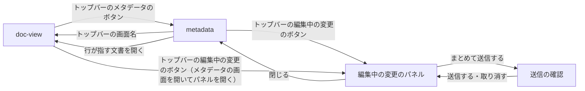

# 画面

## 現状

<!-- table: {"kind": "data"} -->

| 分類 | ページ / ファイル | 概要 | 補足 |
| --- | --- | --- | --- |
| ドキュメント | [docs/scenario/SC-155-13.yaml](https://docs.shuhdev.com/dev-docs/docs/scenario/SC-155-13.yaml?rev=develop) | dev-docsで配信元の文書を画面で参照する（複合ユースケース） | メタデータの一覧と直コミットの工程を加える |
| ドキュメント | [docs/scenario/SC-155-7.yaml](https://docs.shuhdev.com/dev-docs/docs/scenario/SC-155-7.yaml?rev=develop) | 利用者が画面で参照する | 実行のみ |
| ドキュメント | [docs/scenario/SC-155-6.yaml](https://docs.shuhdev.com/dev-docs/docs/scenario/SC-155-6.yaml?rev=develop) | 利用者がコメントを送信する | 画面で溜めて送信する流れの前例 |
| ドキュメント | [docs/screen/SCR-155-1.yaml](https://docs.shuhdev.com/dev-docs/docs/screen/SCR-155-1.yaml?rev=develop) | 文書の画面 | メタデータの一覧への起点を加える候補 |
| ドキュメント | [docs/screen/SCR-155-3.yaml](https://docs.shuhdev.com/dev-docs/docs/screen/SCR-155-3.yaml?rev=develop) | 設定画面 | 変更なしの見込み |
| ドキュメント | [docs/component/CMP-155-2.yaml](https://docs.shuhdev.com/dev-docs/docs/component/CMP-155-2.yaml?rev=develop) | トップバー | 編集中の変更の件数と送信の起点を加える候補 |
| ドキュメント | [docs/module/MOD-155-36.yaml](https://docs.shuhdev.com/dev-docs/docs/module/MOD-155-36.yaml?rev=develop) | 画面 / 文書の画面 / comment-store.ts | ブラウザのタブで溜める配置先の前例 |
| ドキュメント | [docs/module/MOD-155-35.yaml](https://docs.shuhdev.com/dev-docs/docs/module/MOD-155-35.yaml?rev=develop) | 画面 / 文書の画面 / comment-panel.tsx | 溜めたものの一覧のパネルの前例 |
| ドキュメント | [docs/module/MOD-155-7.yaml](https://docs.shuhdev.com/dev-docs/docs/module/MOD-155-7.yaml?rev=develop) | 画面 / アプリとルート / router.tsx | メタデータの画面のルートを加える |
| ドキュメント | [docs/design-policy.md](https://docs.shuhdev.com/dev-docs/docs/design-policy.md?rev=develop) | デザイン方針 | 新規の画面もこの方針に合わせる |

<!-- /table -->

## 変更方針

<!-- table: {"kind": "data"} -->

| 対象 | 方針 | 補足 |
| --- | --- | --- |
| 閲覧機能 | 配信元ごとに、メタデータの種類（用語集・エイリアス・タグ・rule-inject の索引・配信元の設定・管理用の YAML）を切り替えて表で参照する画面を加える。rule-inject の索引は、規約・パス・ツール・引数の列を持つ | 画面の分け方と起点は画面一覧・画面遷移で決める |
| 検索機能 | 一覧の表を値の単語で絞り込める（用語が登録済みか・規約がどのパスに適用されるかを検索する） | - |
| 編集機能 | 一覧の行の値を画面で修正・追加・削除し、送信する前の変更として、編集中の変更をブラウザに保持する。開き直しても残る | 修正できる項目の範囲は要件の `未確定` に従う |
| 一括操作 | 編集中の変更を一覧で確認し、配信元ごとに差分確認で差分を確認してから、まとめて送信する | 送信は開発ドキュメントサーバーの画面の API を経る |
| エラー表示 | 送信できなかった修正を、修正ごとに理由（許可していない種類・検査の違反と修正方法・他の変更との食い違い）と一緒に出し、編集中の変更に残す | - |
| 状態表示 | 送信の途中・送信した後のコミットとブランチ・送信の失敗を出す | - |
| 権限・認可 | 直コミットを許可していない種類の一覧は、参照だけにして修正の操作を出さない | 許可の種類は配信元の設定と project-index の端末の設定から取得する |
| 既存機能への影響 | 文書の画面の参照・検索・差分・コメントは今のまま動く | SC-155-7 を実行のみで確認する |

<!-- /table -->

### 画面一覧

<!-- table: {"kind": "data"} -->

| 種別 | 画面 | 概要 | アクション | 判定の根拠 | 補足 |
| --- | --- | --- | --- | --- | --- |
| 新規 | `metadata` | 1 つの配信元のメタデータを、種類ごとの表で参照・修正する画面（`/{配信元の ID}/_metadata`） | 種類を切り替える 表を単語で絞り込む 行の値を修正する 行を追加する 行を削除する 行が指す文書を開く | 文書の画面と見比べながら操作する関係ではなく、同じ親（配信元）の別の画面のため別画面にする。メタデータの種類は同じ配信元について関連するが別のまとまりのため画面内のタブにする。表の絞り込みは同じ内容の絞り込みのため同じ画面で切り替える。行の修正・追加・削除は 1 件をすばやく修正するだけのため行の中で行う | 直コミットを許可していない種類のタブは、修正・追加・削除の操作を出さず参照だけにする |
| 新規 | `metadata` > 編集中の変更のパネル | 送信していない変更の一覧と、差分確認・コミットの結果 | 変更を元に戻す 変更した行へ移動する 差分確認 コミット | 表を参照しながら編集中の変更を確認するため、画面の横に出すパネルにする | 狭い幅では下から出す面にする |
| 新規 | `metadata` > 送信の確認 | まとめて送信する前の確認（配信元・ブランチ・修正の件数・コミットの説明） | コミットの説明を入力する 送信する 取り消す | 既定のブランチへのプッシュは取り消せない操作のため、モーダルにする | - |
| 変更 | `components/topbar` | トップバー | メタデータの画面を開く 編集中の変更のパネルを開く（件数を出す） | 文書の画面の種類のタブは文書の種類の切り替えで、別画面への移動を混ぜないため、トップバーのボタンから開く。編集中の変更のパネルは、コメントのパネルと同じくトップバーのボタンだけから開く | `screen` に `metadata` を加える。件数は開いている配信元の編集中の変更の件数（送信は配信元ごとのため） |
| 変更 | `doc-view` | 文書の画面 | メタデータの画面を開く 編集中の変更のパネルを開く | トップバーのボタンだけを加え、文書の画面の要素は変えない | 編集中の変更のパネルは、メタデータの画面を開いてから開く |

<!-- /table -->

管理用の YAML（`files.yml`）は 1 つのタブにまとめ、タブの中で配信元の設定の `records` の行を絞り込みで切り替える（モック作成でユーザーが決定）。

### 画面遷移

<!-- map: {"title": "画面遷移"} -->

<!-- /map -->

## 設計書の確定コミット

| 工程 | 範囲 | 補足 |
| --- | --- | --- |
| 複合ユースケース設計 | `d56b2cf..60c6783` | - |
| 複合ユースケース設計 | `60c6783..6fb6930` | レビューの指摘の修正 |
| 単一ユースケース設計 | `d7ba5be..61686f4` | - |
| 単一ユースケース設計 | `61686f4..47b2f81` | レビューの提案の反映 |
| 部品設計・画面設計 | `1418b79..9da47bb` | トップバー（CMP-155-2）・文書の画面（SCR-155-1）の変更と、メタデータの画面（SCR-155-4）の新規作成 |
| 部品設計・画面設計 | `c03b168..def6762` | レビューの指摘の修正 |

## テスト結果

なし（テスト作成・実装の工程で記入する）
