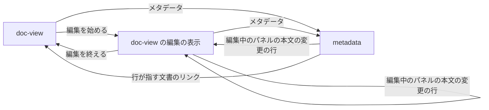

# 画面

## 現状

<!-- table: {"kind": "data"} -->

| 分類 | ページ / ファイル | 概要 | 補足 |
| --- | --- | --- | --- |
| ドキュメント | [文書の画面](https://docs.shuhdev.com/dev-docs/docs/screen/SCR-155-1.yaml?rev=develop) | 1 文書の本文をタブ・サイドバー・パンくず・目次と一緒に参照する | 編集のボタンと編集の部品を加える |
| ドキュメント | [メタデータの画面](https://docs.shuhdev.com/dev-docs/docs/screen/SCR-155-4.yaml?rev=develop) | メタデータの表の編集と、編集中の変更の差分確認・直コミット | 編集中のパネルに文書の本文の変更も並べる |
| ドキュメント | [利用者が画面で参照する](https://docs.shuhdev.com/dev-docs/docs/scenario/SC-155-7.yaml?rev=develop) | 文書の画面の参照のシナリオ | 編集を始める流れが加わる |
| ドキュメント | [利用者が画面で編集中の変更をまとめて直コミットする](https://docs.shuhdev.com/dev-docs/docs/scenario/SC-155-15.yaml?rev=develop) | メタデータの画面の編集と直コミットのシナリオ | 文書の本文の変更も同じ流れで送信する |
| ドキュメント | [dev-docsで配信元の文書を画面で参照する](https://docs.shuhdev.com/dev-docs/docs/scenario/SC-155-13.yaml?rev=develop) | 画面の利用の複合シナリオ | 本文の編集と直コミットが加わる |
| ドキュメント | [文書の画面 / doc-body.tsx](https://docs.shuhdev.com/dev-docs/docs/module/MOD-155-10.tsx.yaml?rev=develop) | mdmark で描く本文 | 目印のブロックに編集のボタンを出す |
| ドキュメント | [文書の画面 / doc-view-screen.tsx](https://docs.shuhdev.com/dev-docs/docs/module/MOD-155-20.tsx.yaml?rev=develop) | 文書の画面の最上位 | 編集のボタンと編集の表示を加える |
| ドキュメント | [メタデータの画面 / pending-edits-store.ts](https://docs.shuhdev.com/dev-docs/docs/module/MOD-155-221.ts.yaml?rev=develop) | 配信元ごとの編集中の変更のストア | 文書の本文の変更を持てるようにする |
| ドキュメント | [メタデータの画面 / metadata-table.tsx](https://docs.shuhdev.com/dev-docs/docs/module/MOD-155-223.tsx.yaml?rev=develop) | 編集できる表 | 本文の平らなオブジェクトの配列の表にも使用する |
| ドキュメント | [メタデータの画面 / pending-panel.tsx](https://docs.shuhdev.com/dev-docs/docs/module/MOD-155-224.tsx.yaml?rev=develop) | 編集中のパネルとコミットの確認のダイアログ | 文書の画面からも開けるようにする |
| ドキュメント | [mdmark](https://docs.shuhdev.com/dev-docs/docs/library/LIB-155-9.yaml?rev=develop) | 本文の描画 | 目印を描いた本文に残せるかを確認する |
| ドキュメント | [画面で参照する](https://docs.shuhdev.com/dev-docs/docs/guide/画面で参照する.md?rev=develop) | 画面の操作の手順 | 本文の編集と直コミットの手順を加える |

<!-- /table -->

## 変更方針

<!-- table: {"kind": "data"} -->

| 対象 | 方針 | 補足 |
| --- | --- | --- |
| 編集のボタン | 文書の画面に `編集` のボタンを配置し、編集できない文書（`write_api_kinds` に無い・`body: false`・SQLite の行）では出さない | 配置は画面設計で決め、必要なら利用者へ確認する |
| ファイル全体の編集 | 元のファイルを、言語（Markdown・YAML）に合うエディタで開き、プレビューと検査の結果を並べる | Markdown・YAML の全ての文書。エディタのライブラリはライブラリ選定で決める |
| 表示した場所の編集 | 目印のあるブロックに編集のボタンを出し、スキーマの型で部品を選ぶ（短い文字列・enum は入力欄・選択肢、Markdown の文字列はエディタとプレビュー、平らなオブジェクトの配列は編集できる表、入れ子のオブジェクトはスキーマから作るフォーム） | YAML の文書だけ |
| 編集中の変更 | 文書の本文の変更をメタデータの変更と同じストアに溜め、同じ編集中のパネル・差分確認・コミットの確認で送信する | 画面をまたいで同じ配信元の変更を 1 つのコミットにする |
| バリデーション | 送信の前に差分確認で project-index の検査を実行し、違反を項目のパスの位置に出す | YAML として解析できない書き換えはエディタの中で出す |
| 状態表示 | 編集中の変更がある文書は、文書の画面とサイドバーで分かるようにする | 画面設計で決める |
| キーボード操作 | ショートカットの一覧にキーを加えない。その場の入力欄は Enter・Esc で編集を終え、保存は編集中のパネルのコミットで行う | [ショートカットの一覧](https://docs.shuhdev.com/dev-docs/docs/component/CMP-155-1.yaml?rev=develop) |
| 既存機能への影響 | メタデータの画面の編集と直コミットの振る舞いを変えない | - |

<!-- /table -->

### 画面一覧

| 種別 | 画面 | 概要 | アクション | 判定の根拠 | 補足 |
| --- | --- | --- | --- | --- | --- |
| 変更 | `doc-view`（`/{配信元}/{パス}`） | 1 文書の本文の参照と、本文の編集 | 編集を始める 表示した場所で値を修正する ファイル全体を編集する 編集を終える 編集中のパネルを開く | 本文の編集は、表示した本文を参照しながら入力するため、別画面にせず文書の画面の中で行う（『画面の分け方』の操作の配置先）。短い文字列・enum の値 1 つの修正と、表の行の修正は、すばやい修正としてその場で行う | ファイル全体の編集は本文の区画の切り替え、表示した場所での Markdown の文字列の項目の編集は画面の横に出すパネルで行う。Markdown の文書はファイル全体の編集だけを持つ |
| 変更 | `metadata`（`/{配信元}/_metadata`） | メタデータの表の編集と、編集中の変更の差分確認・直コミット | 編集中のパネルで本文の変更の行を押す | 編集中の変更は配信元ごとに 1 つで、本文の変更もメタデータの画面の編集中のパネルに並べる | 本文の変更の行を押すと、その文書の文書の画面を開く |
| 変更 | `components/pending-panel` | 編集中のパネルとコミットの確認のダイアログ | 差分確認 コミット 変更を元に戻す 変更の行へ移動 | 文書の画面とメタデータの画面の両方で、本文・表を参照しながら開いておくため、画面の横に出すパネルのまま両方の画面に配置する | 今はメタデータの画面の要素。部品設計で部品にする |
| 変更 | `components/topbar` | 編集中のボタン | 編集中のパネルを開く | 文書の画面でも編集中のパネルを開くため、メタデータの画面へ移らずにその画面でパネルを開く | `pendingPanelToggle` の文書の画面での振る舞いが変わる |

ファイル全体の編集は、文書の画面の本文の区画を、エディタとプレビューを左右に並べた編集の表示に切り替える（URL の search に `edit` を持たせる。狭い幅では縦に並べる）。
表示した本文と同じ文書の見せ方の切り替え（『画面の分け方』の「同じ内容の見せ方の切り替え」）で、編集中の変更をパネルで確認しながら続けられるため。

表示した場所での Markdown の文字列の項目（規約の `items[].body`、プロンプトの `texts[]` など）は、ブロックの編集のボタンを押すと画面の横に出すパネルにエディタとプレビューを出して編集する（狭い幅では下から出す）。
元の本文を参照しながら入力する操作で、判定表では画面の横に出すパネルになるため。
パネルは、編集中のパネル・コメントのパネルと同じく本文の上に重ねる。

### 画面遷移

`DE` は文書の画面の中の表示の切り替えで、別画面ではない。
今の「文書の画面で編集中のボタンを押すとメタデータの画面を開いてパネルを開く」遷移は、文書の画面でパネルを開く振る舞いに変える。

## 設計書の確定コミット

| 工程 | 範囲 | 補足 |
| --- | --- | --- |
| 複合ユースケース設計 | `c07f4e5..0dd7cb0` | - |
| 複合ユースケース設計 | `0dd7cb0..0e2f868` | レビューの指摘の修正 |
| 単一ユースケース設計 | `0e2f868..a0a72f0` | - |
| 単一ユースケース設計 | `0caf34e..40ab134` | レビューの指摘の修正 |
| 部品設計 | `622c25e..aea745d` | - |
| 画面設計 | `aea745d..0a98372` | - |
| 画面設計 | `752ee39..54f6463` | レビューの指摘の修正 |
| モジュール構成設計 | `a71d060..41efff6` | - |
| モジュール構成設計 | `185209b..3f7a14f` | レビューの指摘の修正 |
| モジュール構成設計 | `d9b9e10..697d1dc` | 単体テスト作成で見つけた YAML のライブラリの食い違いの修正 |
| モジュール構成設計 | `59ad964..6ec581a` | 実装のレビューの指摘の修正（`$` を含む値の単体テスト） |
| 画面設計 | `3efdd6c..ea05b0f` | 結合テスト作成で見つけた食い違いの修正（文書の画面の `panel`） |
| モジュール構成設計 | `3efdd6c..ea05b0f` | 結合テスト作成で見つけた食い違いの修正（編集の方式の切り替え・本文の変更の行へ移動） |

## 実装

| 項目 | 内容 |
| --- | --- |
| 足した・直したストーリー | `layout-pendingpanel--metadata-edits` / `layout-pendingpanel--body-edits` / `layout-pendingpanel--dry-run-diff` / `layout-pendingpanel--body-edit-invalid` / `layout-pendingpanel--conflict` / `layout-pendingpanel--empty` / `layout-pendingpanel--long-labels` / `layout-pendingpanel--narrow` |

## テスト結果

### 単体

| ファイル | メソッド | 変更種別 | 結果 | 補足 |
| --- | --- | --- | --- | --- |
| `tests/unit/frontend/src/features/docs/doc-view/edit.test.ts` | 全実行 | 新規 | ✅ | `テスト結果/20261127012558_0665a17_単体テスト.log` |
| `tests/unit/frontend/src/features/docs/doc-view/components/doc-edit-bar.test.tsx` | 全実行 | 新規 | ✅ | `テスト結果/20261127012558_0665a17_単体テスト.log` |
| `tests/unit/frontend/src/features/docs/doc-view/components/doc-field-editor.test.tsx` | 全実行 | 新規 | ✅ | `テスト結果/20261127012558_0665a17_単体テスト.log` |
| `tests/unit/frontend/src/features/docs/doc-view/components/markdown-field-panel.test.tsx` | 全実行 | 新規 | ✅ | `テスト結果/20261127012558_0665a17_単体テスト.log` |
| `tests/unit/frontend/src/features/docs/doc-view/components/markdown-preview.test.tsx` | 全実行 | 新規 | ✅ | `テスト結果/20261127012558_0665a17_単体テスト.log` |
| `tests/unit/frontend/src/features/docs/doc-view/components/whole-file-editor.test.tsx` | 全実行 | 新規 | ✅ | `テスト結果/20261127012558_0665a17_単体テスト.log` |
| `tests/unit/frontend/src/features/docs/doc-view/doc-view-screen.test.tsx` | 全実行 | 変更 | ✅ | `テスト結果/20261127012558_0665a17_単体テスト.log` |
| `tests/unit/frontend/src/shared/stores/pending-edits-store.test.ts` | 全実行 | 変更 | ✅ | 移動 `テスト結果/20261127012558_0665a17_単体テスト.log` |
| `tests/unit/frontend/src/shared/components/pending-panel/pending-panel.test.tsx` | 全実行 | 変更 | ✅ | 移動 `テスト結果/20261127012558_0665a17_単体テスト.log` |
| `tests/unit/frontend/src/shared/components/pending-panel/queries.test.tsx` | 全実行 | 変更 | ✅ | 移動 `テスト結果/20261127012558_0665a17_単体テスト.log` |
| `tests/unit/frontend/` | 全実行 | 実行のみ | ✅ | 258 テスト pass（ランナー） `テスト結果/20261127012558_0665a17_単体テスト.log` |

単体テストの Red のログは `テスト結果/20261126235700_73e267d_単体テスト.log`。
実装で設計と食い違っていたテストを次のとおり修正した（`6cc146c`・`adb4bf9`）。

| テスト | 理由 |
| --- | --- |
| `test_preview_document_when_converter` | 偽物の文書の取得の追加の値を、ページのパスではなく文書のファイルのパスで配置する |
| `test_schema_to_markdown_when_item_ranges` | `x-key` の値は要素の見出しに描き、要素の中の項目として描かないため、`#items[i1].id` を期待値から除く |
| `test_item_expected_versions_when_body` | 同じ文書の `@file` と項目のパスの変更は要求の検証で断るため、`@file` を別の文書の変更にする |
| `test_build_app_when_openapi` | 本文のプレビューのルートの operationId（`view-post_preview`）を加える |
| `test_markdown_preview` ほか mdmark を使用する部品のテスト | 描き終えた後の本文の変更は `mount` ではなく `update` で渡るため、両方の呼び出しで描いた本文を確かめる。`commentStore` の読み込みは `load` |

実装のレビューの指摘で、`test_doc_field_editor_when_value_has_dollar`（`$&`・`$$`・`$'` を含む値をそのまま描く）を加えた（`5956d52`）。

ドキュメント修正は、ガイドとアーキテクチャ図の文章だけの変更のため、関係する単体・結合テストはありません。

### 結合テストの実行範囲

| 変更したファイル | 結果 | 実行する結合テスト | 結合テストが無いエントリーポイント |
| --- | --- | --- | --- |
| `docs/architecture/ARCH-155-1.yaml` | R7（画面の結合テストが参照しない） | - | - |
| `docs/component/CMP-155-2.yaml` | R7（画面の結合テストが参照しない） | - | - |
| `docs/component/CMP-155-4.yaml` | R7（画面の結合テストが参照しない） | - | - |
| `docs/component/index.yaml` | R7（画面の結合テストが参照しない） | - | - |
| `docs/external-api/API-155-1.yaml` | R7（画面の結合テストが参照しない） | - | - |
| `docs/guide/画面で参照する.md` | R7（画面の結合テストが参照しない） | - | - |
| `docs/guide/設定.md` | R7（画面の結合テストが参照しない） | - | - |
| `docs/interface/IF-155-10.yaml` | R7（画面の結合テストが参照しない） | - | - |
| `docs/interface/IF-155-28.yaml` | R7（画面の結合テストが参照しない） | - | - |
| `docs/interface/IF-155-29.yaml` | R7（画面の結合テストが参照しない） | - | - |
| `docs/interface/IF-155-31.yaml` | R7（画面の結合テストが参照しない） | - | - |
| `docs/interface/index.yaml` | R7（画面の結合テストが参照しない） | - | - |
| `docs/module/MOD-155-100.py.yaml` | R7（画面の結合テストが参照しない） | - | - |
| `docs/module/MOD-155-159.py.yaml` | R7（画面の結合テストが参照しない） | - | - |
| `docs/module/MOD-155-162.py.yaml` | R7（画面の結合テストが参照しない） | - | - |
| `docs/module/MOD-155-20.tsx.yaml` | R7（画面の結合テストが参照しない） | - | - |
| `docs/module/MOD-155-218.py.yaml` | R7（画面の結合テストが参照しない） | - | - |
| `docs/module/MOD-155-219.py.yaml` | R7（画面の結合テストが参照しない） | - | - |
| `docs/module/MOD-155-221.ts.yaml` | R7（画面の結合テストが参照しない） | - | - |
| `docs/module/MOD-155-222.ts.yaml` | R7（画面の結合テストが参照しない） | - | - |
| `docs/module/MOD-155-224.tsx.yaml` | R7（画面の結合テストが参照しない） | - | - |
| `docs/module/MOD-155-225.tsx.yaml` | R7（画面の結合テストが参照しない） | - | - |
| `docs/module/MOD-155-229.py.yaml` | R7（画面の結合テストが参照しない） | - | - |
| `docs/module/MOD-155-230.ts.yaml` | R7（画面の結合テストが参照しない） | - | - |
| `docs/module/MOD-155-231.tsx.yaml` | R7（画面の結合テストが参照しない） | - | - |
| `docs/module/MOD-155-232.tsx.yaml` | R7（画面の結合テストが参照しない） | - | - |
| `docs/module/MOD-155-233.tsx.yaml` | R7（画面の結合テストが参照しない） | - | - |
| `docs/module/MOD-155-234.tsx.yaml` | R7（画面の結合テストが参照しない） | - | - |
| `docs/module/MOD-155-235.tsx.yaml` | R7（画面の結合テストが参照しない） | - | - |
| `docs/module/MOD-155-28.ts.yaml` | R7（画面の結合テストが参照しない） | - | - |
| `docs/module/MOD-155-97.py.yaml` | R7（画面の結合テストが参照しない） | - | - |
| `docs/module/MOD-155-99.py.yaml` | R7（画面の結合テストが参照しない） | - | - |
| `docs/module/index.yaml` | R7（画面の結合テストが参照しない） | - | - |
| `docs/pr/335/README.mark.md` | R7（画面の結合テストが参照しない） | - | - |
| `docs/pr/335/タスク一覧.yaml` | R7（画面の結合テストが参照しない） | - | - |
| `docs/pr/335/テスト結果/20261126235700_73e267d_単体テスト.log` | R7（画面の結合テストが参照しない） | - | - |
| `docs/pr/335/テスト結果/20261126235809_73e267d_lint.log` | R7（画面の結合テストが参照しない） | - | - |
| `docs/pr/335/テスト結果/20261127001856_dd24ab3_lint.log` | R7（画面の結合テストが参照しない） | - | - |
| `docs/pr/335/テスト結果/20261127001856_dd24ab3_単体テスト.log` | R7（画面の結合テストが参照しない） | - | - |
| `docs/pr/335/テスト結果/20261127003022_5956d52_lint.log` | R7（画面の結合テストが参照しない） | - | - |
| `docs/pr/335/テスト結果/20261127003022_5956d52_単体テスト.log` | R7（画面の結合テストが参照しない） | - | - |
| `docs/pr/335/テスト結果/20261127012558_0665a17_lint.log` | R7（画面の結合テストが参照しない） | - | - |
| `docs/pr/335/テスト結果/20261127012558_0665a17_単体テスト.log` | R7（画面の結合テストが参照しない） | - | - |
| `docs/pr/335/テスト結果/20261127012558_0665a17_結合テスト.log` | R7（画面の結合テストが参照しない） | - | - |
| `docs/pr/335/画面.mark.md` | R7（画面の結合テストが参照しない） | - | - |
| `docs/pr/335/確認ログ.yaml` | R7（画面の結合テストが参照しない） | - | - |
| `docs/pr/335/要件.mark.md` | R7（画面の結合テストが参照しない） | - | - |
| `docs/pr/335/要件.yaml` | R7（画面の結合テストが参照しない） | - | - |
| `docs/pr/335/開発ドキュメントサーバー.mark.md` | R7（画面の結合テストが参照しない） | - | - |
| `docs/scenario/SC-155-13.yaml` | R7（画面の結合テストが参照しない） | - | - |
| `docs/scenario/SC-155-15.yaml` | R7（画面の結合テストが参照しない） | - | - |
| `docs/screen/SCR-155-1.yaml` | R7（画面の結合テストが参照しない） | - | - |
| `docs/screen/SCR-155-4.yaml` | R7（画面の結合テストが参照しない） | - | - |
| `frontend/files.yaml` | R7（画面の結合テストが参照しない） | - | - |
| `frontend/openapi.json` | R7（変更したファイルを参照する結合テスト） | `tests/integration/frontend/doc-view-screen.spec.ts` `tests/integration/frontend/metadata-screen.spec.ts` | - |
| `frontend/src/features/docs/doc-view/components/doc-edit-bar.tsx` | R7（変更したファイルを参照する結合テスト） | `tests/integration/frontend/doc-view-screen.spec.ts` | - |
| `frontend/src/features/docs/doc-view/components/doc-field-editor.tsx` | R7（変更したファイルを参照する結合テスト） | `tests/integration/frontend/doc-view-screen.spec.ts` | - |
| `frontend/src/features/docs/doc-view/components/doc-header.tsx` | R7（変更したファイルを参照する結合テスト） | `tests/integration/frontend/doc-view-screen.spec.ts` | - |
| `frontend/src/features/docs/doc-view/components/doc-main.tsx` | R7（変更したファイルを参照する結合テスト） | `tests/integration/frontend/doc-view-screen.spec.ts` | - |
| `frontend/src/features/docs/doc-view/components/markdown-field-panel.tsx` | R7（変更したファイルを参照する結合テスト） | `tests/integration/frontend/doc-view-screen.spec.ts` | - |
| `frontend/src/features/docs/doc-view/components/markdown-preview.tsx` | R7（変更したファイルを参照する結合テスト） | `tests/integration/frontend/doc-view-screen.spec.ts` | - |
| `frontend/src/features/docs/doc-view/components/whole-file-editor.tsx` | R7（変更したファイルを参照する結合テスト） | `tests/integration/frontend/doc-view-screen.spec.ts` | - |
| `frontend/src/features/docs/doc-view/doc-view-screen.stories.tsx` | R7（変更したファイルを参照する結合テスト） | `tests/integration/frontend/doc-view-screen.spec.ts` | - |
| `frontend/src/features/docs/doc-view/doc-view-screen.tsx` | R7（変更したファイルを参照する結合テスト） | `tests/integration/frontend/doc-view-screen.spec.ts` | - |
| `frontend/src/features/docs/doc-view/edit.ts` | R7（変更したファイルを参照する結合テスト） | `tests/integration/frontend/doc-view-screen.spec.ts` | - |
| `frontend/src/features/docs/doc-view/search.ts` | R7（変更したファイルを参照する結合テスト） | `tests/integration/frontend/doc-view-screen.spec.ts` | - |
| `frontend/src/features/metadata/metadata/metadata-screen.stories.tsx` | R7（変更したファイルを参照する結合テスト） | `tests/integration/frontend/metadata-screen.spec.ts` | - |
| `frontend/src/features/metadata/metadata/metadata-screen.tsx` | R7（変更したファイルを参照する結合テスト） | `tests/integration/frontend/metadata-screen.spec.ts` | - |
| `frontend/src/features/metadata/metadata/metadata-table.tsx` | R7（変更したファイルを参照する結合テスト） | `tests/integration/frontend/metadata-screen.spec.ts` | - |
| `frontend/src/features/metadata/metadata/pending-panel.tsx` | R7（変更したファイルを参照する結合テスト） | `tests/integration/frontend/pending-panel.spec.ts` `tests/integration/frontend/doc-view-screen.spec.ts` `tests/integration/frontend/metadata-screen.spec.ts` | - |
| `frontend/src/features/metadata/metadata/queries.ts` | R7（変更したファイルを参照する結合テスト） | `tests/integration/frontend/pending-panel.spec.ts` `tests/integration/frontend/doc-view-screen.spec.ts` `tests/integration/frontend/metadata-screen.spec.ts` | - |
| `frontend/src/features/metadata/shared/pending-edits-store.ts` | R7（変更したファイルを参照する結合テスト） | `tests/integration/frontend/pending-panel.spec.ts` `tests/integration/frontend/doc-view-screen.spec.ts` `tests/integration/frontend/metadata-screen.spec.ts` | - |
| `frontend/src/shared/api/generated/model/documentEdit.ts` | R7（変更したファイルを参照する結合テスト） | `tests/integration/frontend/doc-view-screen.spec.ts` `tests/integration/frontend/metadata-screen.spec.ts` | - |
| `frontend/src/shared/api/generated/model/documentEditLanguage.ts` | R7（変更したファイルを参照する結合テスト） | `tests/integration/frontend/doc-view-screen.spec.ts` `tests/integration/frontend/metadata-screen.spec.ts` | - |
| `frontend/src/shared/api/generated/model/documentResponse.ts` | R7（変更したファイルを参照する結合テスト） | `tests/integration/frontend/doc-view-screen.spec.ts` `tests/integration/frontend/metadata-screen.spec.ts` | - |
| `frontend/src/shared/api/generated/model/editBlock.ts` | R7（変更したファイルを参照する結合テスト） | `tests/integration/frontend/doc-view-screen.spec.ts` `tests/integration/frontend/metadata-screen.spec.ts` | - |
| `frontend/src/shared/api/generated/model/editBlockType.ts` | R7（変更したファイルを参照する結合テスト） | `tests/integration/frontend/doc-view-screen.spec.ts` `tests/integration/frontend/metadata-screen.spec.ts` | - |
| `frontend/src/shared/api/generated/model/editBlockValue.ts` | R7（変更したファイルを参照する結合テスト） | `tests/integration/frontend/doc-view-screen.spec.ts` `tests/integration/frontend/metadata-screen.spec.ts` | - |
| `frontend/src/shared/api/generated/model/editKind.ts` | R7（変更したファイルを参照する結合テスト） | `tests/integration/frontend/doc-view-screen.spec.ts` `tests/integration/frontend/metadata-screen.spec.ts` | - |
| `frontend/src/shared/api/generated/model/editValues.ts` | R7（変更したファイルを参照する結合テスト） | `tests/integration/frontend/doc-view-screen.spec.ts` `tests/integration/frontend/metadata-screen.spec.ts` | - |
| `frontend/src/shared/api/generated/model/index.ts` | R7（変更したファイルを参照する結合テスト） | `tests/integration/frontend/doc-view-screen.spec.ts` `tests/integration/frontend/metadata-screen.spec.ts` | - |
| `frontend/src/shared/api/generated/model/previewRequest.ts` | R7（変更したファイルを参照する結合テスト） | `tests/integration/frontend/doc-view-screen.spec.ts` `tests/integration/frontend/metadata-screen.spec.ts` | - |
| `frontend/src/shared/api/generated/model/previewResponse.ts` | R7（変更したファイルを参照する結合テスト） | `tests/integration/frontend/doc-view-screen.spec.ts` `tests/integration/frontend/metadata-screen.spec.ts` | - |
| `frontend/src/shared/api/generated/view/view.faker.ts` | R7（変更したファイルを参照する結合テスト） | `tests/integration/frontend/doc-view-screen.spec.ts` `tests/integration/frontend/metadata-screen.spec.ts` | - |
| `frontend/src/shared/api/generated/view/view.msw.ts` | R7（変更したファイルを参照する結合テスト） | `tests/integration/frontend/doc-view-screen.spec.ts` `tests/integration/frontend/metadata-screen.spec.ts` | - |
| `frontend/src/shared/api/generated/view/view.ts` | R7（変更したファイルを参照する結合テスト） | `tests/integration/frontend/doc-view-screen.spec.ts` `tests/integration/frontend/metadata-screen.spec.ts` | - |
| `frontend/src/shared/api/generated/zod/metadata/metadata.zod.ts` | R7（変更したファイルを参照する結合テスト） | `tests/integration/frontend/doc-view-screen.spec.ts` `tests/integration/frontend/metadata-screen.spec.ts` | - |
| `frontend/src/shared/api/generated/zod/view/view.zod.ts` | R7（変更したファイルを参照する結合テスト） | `tests/integration/frontend/doc-view-screen.spec.ts` `tests/integration/frontend/metadata-screen.spec.ts` | - |
| `frontend/src/shared/components/pending-panel/pending-panel.stories.tsx` | R7（変更したファイルを参照する結合テスト） | `tests/integration/frontend/pending-panel.spec.ts` `tests/integration/frontend/doc-view-screen.spec.ts` `tests/integration/frontend/metadata-screen.spec.ts` | - |
| `frontend/src/shared/styles/index.css` | R7（変更したファイルを参照する結合テスト） | `tests/integration/frontend/doc-view-screen.spec.ts` | - |
| `src/dev_docs/features/convert/markdown.py` | R7（画面の結合テストが参照しない） | - | - |
| `src/dev_docs/features/convert/service.py` | R7（画面の結合テストが参照しない） | - | - |
| `src/dev_docs/features/convert/types.py` | R7（画面の結合テストが参照しない） | - | - |
| `src/dev_docs/features/metadata/commits.py` | R7（画面の結合テストが参照しない） | - | - |
| `src/dev_docs/features/metadata/route.py` | R7（画面の結合テストが参照しない） | - | - |
| `src/dev_docs/features/view/document.py` | R7（画面の結合テストが参照しない） | - | - |
| `src/dev_docs/features/view/edit.py` | R7（画面の結合テストが参照しない） | - | - |
| `src/dev_docs/features/view/route.py` | R7（画面の結合テストが参照しない） | - | - |
| `src/dev_docs/features/view/types.py` | R7（画面の結合テストが参照しない） | - | - |
| `src/dev_docs/screen/assets/index-CfS2XgvQ.css` | R7（変更したファイルを参照する結合テスト） | `tests/integration/frontend/doc-view-screen.spec.ts` | - |
| `src/dev_docs/screen/assets/index-DBl_WbI7.css` | R7（変更したファイルを参照する結合テスト） | `tests/integration/frontend/doc-view-screen.spec.ts` | - |
| `src/dev_docs/screen/assets/index-DCmbF9QZ.js` | R7（変更したファイルを参照する結合テスト） | `tests/integration/frontend/doc-view-screen.spec.ts` | - |
| `src/dev_docs/screen/index.html` | R7（変更したファイルを参照する結合テスト） | `tests/integration/frontend/doc-view-screen.spec.ts` | - |
| `src/files.yaml` | R7（画面の結合テストが参照しない） | - | - |
| `tests/files.yaml` | R7（画面の結合テストが参照しない） | - | - |
| `tests/integration/frontend/doc-view-screen.spec.ts` | R2 | `tests/integration/frontend/doc-view-screen.spec.ts` | - |
| `tests/integration/frontend/metadata-screen.spec.ts` | R2 | `tests/integration/frontend/metadata-screen.spec.ts` | - |
| `tests/integration/frontend/pending-panel.spec.ts` | R2 | `tests/integration/frontend/pending-panel.spec.ts` | - |
| `tests/integration/server/conftest.py` | R7（画面の結合テストが参照しない） | - | - |
| `tests/integration/server/test_api_schema.py` | R7（画面の結合テストが参照しない） | - | - |
| `tests/integration/server/test_get_document.py` | R7（画面の結合テストが参照しない） | - | - |
| `tests/integration/server/test_post_commits.py` | R7（画面の結合テストが参照しない） | - | - |
| `tests/integration/server/test_post_preview.py` | R7（画面の結合テストが参照しない） | - | - |
| `tests/unit/dev_docs/features/convert/test_markdown.py` | R7（画面の結合テストが参照しない） | - | - |
| `tests/unit/dev_docs/features/metadata/test_commits.py` | R7（画面の結合テストが参照しない） | - | - |
| `tests/unit/dev_docs/features/view/test_document.py` | R7（画面の結合テストが参照しない） | - | - |
| `tests/unit/dev_docs/features/view/test_edit.py` | R7（画面の結合テストが参照しない） | - | - |
| `tests/unit/dev_docs/features/view/test_route.py` | R7（画面の結合テストが参照しない） | - | - |
| `tests/unit/dev_docs/server/test_app.py` | R7（画面の結合テストが参照しない） | - | - |
| `tests/unit/frontend/helpers/fixtures.ts` | R7（画面の結合テストが参照しない） | - | - |
| `tests/unit/frontend/src/features/docs/doc-view/components/doc-edit-bar.test.tsx` | R7（画面の結合テストが参照しない） | - | - |
| `tests/unit/frontend/src/features/docs/doc-view/components/doc-field-editor.test.tsx` | R7（画面の結合テストが参照しない） | - | - |
| `tests/unit/frontend/src/features/docs/doc-view/components/doc-main.test.tsx` | R7（画面の結合テストが参照しない） | - | - |
| `tests/unit/frontend/src/features/docs/doc-view/components/markdown-field-panel.test.tsx` | R7（画面の結合テストが参照しない） | - | - |
| `tests/unit/frontend/src/features/docs/doc-view/components/markdown-preview.test.tsx` | R7（画面の結合テストが参照しない） | - | - |
| `tests/unit/frontend/src/features/docs/doc-view/components/whole-file-editor.test.tsx` | R7（画面の結合テストが参照しない） | - | - |
| `tests/unit/frontend/src/features/docs/doc-view/doc-view-screen.test.tsx` | R7（画面の結合テストが参照しない） | - | - |
| `tests/unit/frontend/src/features/docs/doc-view/edit.test.ts` | R7（画面の結合テストが参照しない） | - | - |
| `tests/unit/frontend/src/features/metadata/metadata/metadata-screen.test.tsx` | R7（画面の結合テストが参照しない） | - | - |
| `tests/unit/frontend/src/features/metadata/metadata/metadata-table.test.tsx` | R7（画面の結合テストが参照しない） | - | - |
| `tests/unit/frontend/src/features/metadata/metadata/pending-panel.test.tsx` | R7（画面の結合テストが参照しない） | - | - |
| `tests/unit/frontend/src/features/metadata/metadata/queries.test.tsx` | R7（画面の結合テストが参照しない） | - | - |
| `tests/unit/frontend/src/features/metadata/shared/pending-edits-store.test.ts` | R7（画面の結合テストが参照しない） | - | - |

### 結合

| ファイル | メソッド | 変更種別 | 結果 | 補足 |
| --- | --- | --- | --- | --- |
| `tests/integration/frontend/doc-view-screen.spec.ts` | 編集のボタン・編集の方式の切り替え・編集を終了・項目のブロック・表のセル・Markdown の項目のパネル・ファイル全体のエディタ・編集中のパネルの describe | 変更 | ✅ | `テスト結果/20261127012558_0665a17_結合テスト.log` |
| `tests/integration/frontend/metadata-screen.spec.ts` | 文書の本文の変更の describe | 変更 | ✅ | `テスト結果/20261127012558_0665a17_結合テスト.log` |
| `tests/integration/frontend/pending-panel.spec.ts` | 全実行 | 新規 | ✅ | `テスト結果/20261127012558_0665a17_結合テスト.log` |
| 実行範囲の表の 3 ファイル | 全実行 | 実行のみ | ✅ | ランナーで 203 テスト pass `テスト結果/20261127012558_0665a17_結合テスト.log` |

設計の変更に合わせて、既存のテストを次のとおり変えた（`8c663e6`・`ebb2910`）。

| テスト | 理由 |
| --- | --- |
| `open_pending_panel`（`doc-view-screen.spec.ts`） | トップバーの編集中のボタンは、メタデータの画面へ移らず、文書の画面の編集中のパネルを開閉する（SCR-155-1 の `pendingPanelToggle`） |
| `doc_title_matches_mdmark_h1`（`doc-view-screen.spec.ts`） | 区切り線を、文書のタイトルと編集のボタンを並べる行の下に引くようにしたため、h1 の親の要素の線を確かめる |
| `test_doc_edit_bar_when_other_mode_pending`（`doc-edit-bar.test.tsx`） | MOD-155-231 の修正のとおり、今の方式の変更があるときに押していない方を無効にする |
| `test_metadata_screen_when_locate_body`（`metadata-screen.test.tsx`） | MOD-155-225 に加えた本文の変更の行へ移動の単体テスト |
