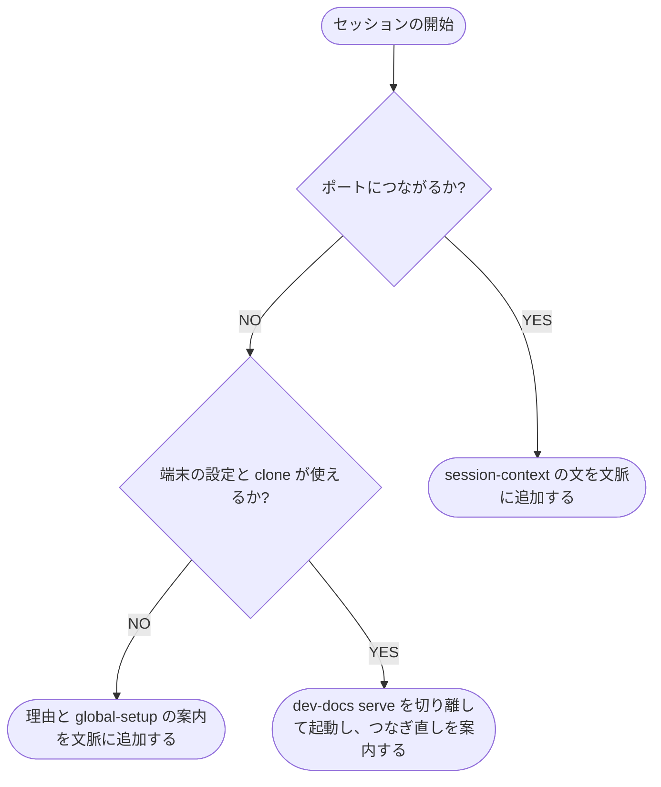

# 管理用プラグイン

プラグインが配る .mcp.json・フック・スキルと、起動・作業場所の受け渡しの仕組み

## 配るもの

dev-docs のリポジトリはマーケットプレイスで、プラグイン `dev-docs` を 1 つ載せています。
利用者はユーザースコープで入れるだけで、どの作業場所でも dev-docs を使えます。
各リポジトリはプラグインを持たず、ai-monitor にも依存しません。

| 配るもの | 内容 |
| --- | --- |
| `.mcp.json` | 文書の MCP `dev-docs`（`http://127.0.0.1:${DEV_DOCS_PORT:-8781}/mcp`）と、管理の MCP `dev-docs-admin`（`/_admin/mcp`） |
| SessionStart のフック | 落ちているサーバーを起動し、使える配信元と警告を文脈に追加する |
| PreToolUse のフック | 文書の MCP のツールの呼び出しに、作業場所とセッションを入れる |
| スキル `/dev-docs:global-setup [クローンのパス]` | 端末の設定・Claude Code の env・起動を用意する |
| スキル `/dev-docs:setup [path]` | フォルダを配信元として登録し、2 回目以降は範囲のファイルと管理用の YAML を突き合わせる |

スキルの使い方は [dev-docsを入れる](../../使い方/dev-docsを入れる.md) と [配信元を配信する](../../使い方/配信元を配信する.md)、管理の MCP の引数は [管理のMCP](../../リファレンス/管理のMCP.md) にあります。

## 起動の仕組み

SessionStart のフックは、セッションが始まるたびに（`startup`・`resume`・`clear`・`compact`・`fork`）実行されます。
フックは Python の標準ライブラリだけで動き、`uv` を前提にしません。

- ポートへの接続は `127.0.0.1:${DEV_DOCS_PORT:-8781}` に 0.5 秒で打ち切る
- 起動は、`DEV_DOCS_CONFIG` が指す端末の設定の `clone:` の行から `{clone}/.venv/bin/python -m dev_docs serve` を組み立て、入出力を切り離して待たずに戻る
- 起動したセッションでは MCP の接続が間に合わないので、`/mcp` でつなぎ直す
- 端末の設定・`clone`・`{clone}/.venv/bin/python` のどれかが無いときは起動せず、理由と `/dev-docs:global-setup` の案内を文脈に追加する
- 複数のセッションが同時に起動しても、待ち受けるのは 1 つだけで、後から起動したプロセスはポート使用中で終わる

どの失敗でも、フックは終了コード 0 で戻り、セッションを止めません。
失敗の理由は文脈に追加します。

## セッションの文脈

つながったときは、フックが `POST /_admin/session-context` に `cwd`・`session_id`・`agent_id`・`reason`（セッションの開始の理由）を送信し、返った文を文脈に追加します。
文脈が返らなかったとき（打ち切り・200 以外）は、理由と `status` で確かめる案内を追加します。

文は次の順に並びます。

| 部分 | 内容 |
| --- | --- |
| 配信元の一覧 | `cwd` から使える配信元ごとに 1 行。ID・読み書きか読み取りだけか・`description` |
| 使い分けの案内 | ツールの使い方とタグの付け方は文書の MCP の `instructions` にある旨の 1 行（[文書のMCP](../../リファレンス/文書のMCP.md)） |
| 注意 | 索引の同期の件数が 0 でない配信元、設定のバージョンが古い配信元と端末の設定、エイリアスのキーの違反がある配信元、どの文書にも当たらない `nav` の条件、配信していない配信元 |

- 使える配信元が 0 件のときは、`/dev-docs:setup` の案内だけを返す
- 文は 1,000 字以内に収める。超えるときは配信元の `description` を省き、それでも超えるときは配信元の行を切って残りの件数を添える
- `reason` が `clear`・`compact` のときは、そのセッションの返し済みの記録を削除する。文書の MCP が前に返した文書の本文を省かなくなる

`POST /_admin/session-context` は、フックだけが呼ぶ入口です。
管理の MCP のツールにせず、画面の API のスキーマ（`/_api/openapi.json`）にも載せません。

範囲のファイルを作った・削除した・改名したときに、索引へ反映するフックは置きません。
管理用の YAML の行はエージェントが修正し、ずれは次のセッションの注意で件数が知らされます。

## 作業場所の受け渡し

PreToolUse のフックは、文書の MCP（`dev-docs`）のツールの呼び出しだけに当たります。
管理の MCP（`dev-docs-admin`）のツールには当たりません。

フックは、ツールの入力に `cwd`・`session_id`・`agent_id`（サブエージェントのときだけ）を入れて返します。
エージェントが入れた値があっても、フックの値で上書きします。
作業場所を偽って、`scope` の外を読み書きさせないためです。
入力の残りのキーは変えません。

フックは許可の判定を返さず、利用者の許可の設定を変えません。
入力が JSON として読めないときは、何も出さずに戻ります。

入れた `cwd` が、配信元の権限と読み書きの先を決めます。
仕組みは [配信元と権限](./配信元と権限.md) にあります。
