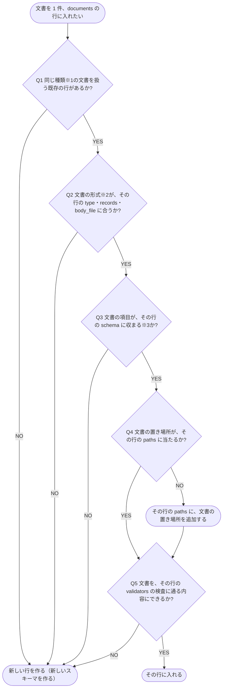

# documentsの行の判定

文書を既存の documents の行に入れるか、新しい行（新しいスキーマ）を作るかを決める判定フローチャート

documents の行は、`dev-docs.yaml` の `documents[]` の 1 行です。
各キーは [設定](../リファレンス/設定.md) の `documents[]` にあります。

## 判定フローチャート

- **※1 種類**: 同じ形式・同じスキーマ・同じ検査で扱う文書のまとまり。行の `id` が文書の `kind` になり、`describe(source)` の `kinds[]` で一覧できる
- **※2 形式**: Markdown か YAML か、YAML の 1 ファイルが 1 文書か、配列の各要素が 1 文書か（`records`）、本文が別のファイルか（`body_file`）。ソースコードなど YAML でない文書は管理用の YAML の `files[]` の 1 行として扱い、`records: files`・`body_file: path` の行が形式に合う行になる
- **※3 収まる**: 文書が `schema` の必須の項目を全て持ち、持たせたい項目が全て `schema` にあること。`describe(source, kind)` でスキーマを見て確かめる。列名が共通のキー（`name`・`tags` など）と違うだけなら行の `metadata` の `ref` が対応づけるので、収まらない理由にしない

## 判定に使うキー

| 判定 | キー |
| --- | --- |
| Q1 | `documents[].id` |
| Q2 | `documents[].type`・`documents[].records`・`documents[].body_file` |
| Q3 | `documents[].schema`（列名の違いは `documents[].metadata`） |
| Q4 | `documents[].paths[]` |
| Q5 | `documents[].validators[]` |

## 新しい行を作るとき

- `id`・`type`・`paths[]`・`schema` を記載し、検査があれば `validators[]` を記載する
- YAML でない文書は管理用の YAML を作り、`records: files`・`body_file: path` で指す（[配信元を配信する](./配信元を配信する.md) の「ソースコードを配信する」）
- 列名が共通のキーと違うときは `metadata` で対応づけ、行の文書に共通のタグは `defaults[]` で付ける
