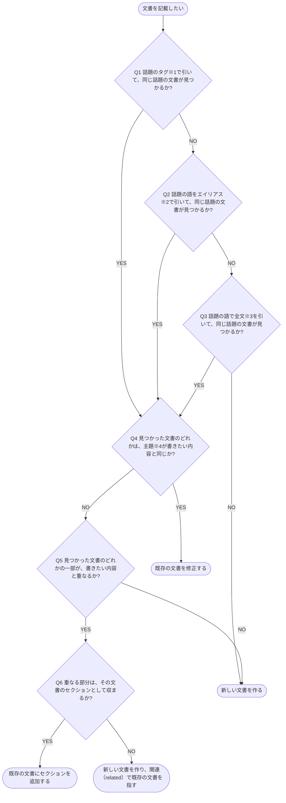

# 新しく作るか修正するかの判定

文書を記載する前に、同じ話題の文書を検索で引き、新しく作るか既存の文書を修正するかを決める判定フローチャート

## 判定フローチャート

- **※1 タグ**: 文書の `tags`。`search_docs` の `filter` で `tags` を指して引く。配信元のタグは `group_by: tags` で一覧できる
- **※2 エイリアス**: 文書の別名。`search_docs` の用語の検索で、`alias_type` を持つ文書の `name` と `aliases` の値を照合して引く（[#11](https://github.com/shuhei1101/dev-docs/issues/11) の仕様）
- **※3 全文**: 文書の本文。`search_docs` の `filter` で `body` を指して引く
- **※4 主題**: 文書が説明する対象 1 つ

新しい文書を作るときは、続けて [documentsの行の判定](./documentsの行の判定.md) で入れる行を決めます。
